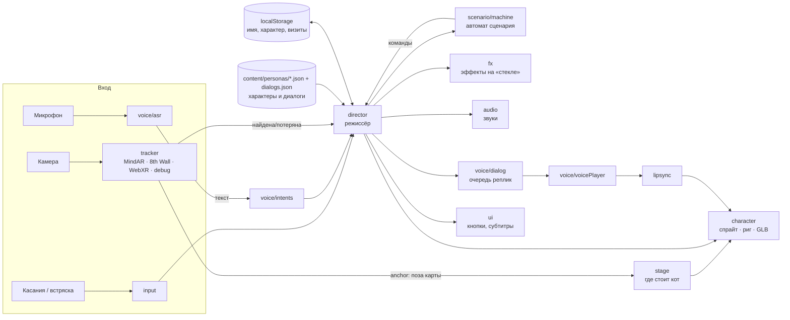

# Архитектура (простым языком)

Приложение — одна веб-страница. Внутри — набор независимых модулей, каждый спрятан за «интерфейсом»
(договором: что модуль умеет и как с ним говорить). Поэтому любую технологию можно заменить, не трогая остальное:
другой трекер карты, другой формат персонажа, другой движок распознавания речи.

## Схема модулей

## Как течёт кадр: «камера → трекер → якорь → персонаж → эффекты/звук»

1. **Камера** даёт видео (рисуется под всем остальным).
2. **Трекер** (`src/tracker`) ищет на видео карту и выдаёт **якорь** — невидимую точку с позой центра карты
   (где карта и как наклонена). Единица длины — ширина карты. Если карта пропала, якорь «замирает» (а у
   MindAR ещё и компенсирует повороты телефона по гироскопу; у 8th Wall/WebXR — продолжает жить в мире).
3. **Stage** (`src/stage.ts`) ставит кота на якорь: точка опоры, рост, поворот к зрителю, тень; умеет водить кота
   по карте к точке тапа и переносить «к стеклу» (ближе к камере).
4. **Персонаж** (`src/character`) — сам кот: проигрывает клипы (idle, прыжок, сальто…), моргает, двигает ртом.
5. **Режиссёр** (`src/director.ts`) получает события (тап, свайп, встряска, голос, «карта потеряна»), отдаёт их
   **автомату сценария** (`src/scenario/machine.ts`) и исполняет его команды: реплика, звук, эффект, кнопка.
6. **Эффекты** (`src/fx`) рисуются поверх всего на 2D-слое — это «стекло» телефона: блёстки, пузырь жвачки,
   царапины, пар, наклейки.
7. **Звук и голос** (`src/audio`, `src/voice`, `src/lipsync`): звуки из аудиоспрайта, реплики из записанных файлов
   (или синтез речи как запасной вариант), рот кота двигается по виземам.

## Шина событий

Модули не вызывают друг друга напрямую, а обмениваются событиями (`src/core/emitter.ts`):

| Источник | События |
|---|---|
| `tracker` | `onFound`, `onLost` |
| `input` | `tap_cat`, `tap_screen`, `longpress`, `swipe`, `shake`, `spam`, `silence`, `activity`, `sticker_tap`, `peel_*` |
| `voice/asr` | `onResult(text)`, `onInterim`, `onLevel`, `onState` |
| `director` | `log`, `phase` (для отладки и аналитики) |

Автомат сценария — **чистая функция** `step(состояние, событие) → (новое состояние, команды)`. Его легко тестировать
(см. `tests/scenario.test.ts`) и менять сценарий, не трогая графику.

## Где что лежит

| Что | Где | Как поменять |
|---|---|---|
| Характеры: реплики, реакции, звуки, эффекты, палитры, голос, наклейки | `content/src/<id>.lines.txt` + `meta.json` → `python3 content/build.py` → `content/personas/<id>.json` (диалоги — `content/dialogs.json`, см. docs/DIALOGS.md) | правка текста, без кода |
| Маркер карты | `public/targets/card.mind` (+ `card.png`) | `npm run compile-target -- новая_карта.png` |
| 3D-модель | `public/models/character.glb` | заменить файл (требования — CHARACTER_SPEC.md) |
| Позы/видео спрайт-режима | `public/video/sprites/` + `manifest.json` | заменить файлы / пути в манифесте |
| Звуки | `public/sounds/sfx.*` + `sfx.json` | `assets-src/audio/*.wav` → `npm run gen-sounds -- --keep-existing` |
| Записанные реплики | `voice-src/<persona>/<id>.wav` → `public/sounds/voice/` | `npm run voice:build` |
| Геометрия «кот на карте» | `src/config.ts` (`defaultStage`) | или слайдеры в `?debug` |

Папки `public/targets`, `/models`, `/sounds`, `/video` на сервере кэшируются надолго — **при замене ассета меняйте
имя файла** (или путь в манифесте), иначе телефоны покажут старую версию.

## Как заменить технологию

| Модуль | Интерфейс | Сейчас | Варианты замены |
|---|---|---|---|
| Трекер | `Tracker` (`src/tracker/types.ts`) + `capabilities {imageTarget, worldTracking, orientationFallback}` | MindAR | 8th Wall (`eighthWallTracker.ts`), WebXR (`webxrTracker.ts`), свой |
| Персонаж | `Character` (`src/character/types.ts`): `play`, `setPersona`, `lookAt`, `emote`, `setMouth` | спрайт (PNG-позы) | `RigCat` (заглушка-риг), `GlbCharacter` (любой GLB), видео с альфой — через манифест спрайтов |
| Эффекты | `FxLayer` (Canvas 2D) | Canvas 2D | PixiJS — тот же набор методов |
| Звук | `Audio` | Howler.js | любой Web Audio |
| Голос: распознавание | `Asr` (`src/voice/asr.ts`) | Web Speech API | Vosk (офлайн, `?asr=vosk`) |
| Голос: ответ | `VoicePlayer` | записи + speechSynthesis-фоллбэк | TTS-сервис — тот же `speak()` |
| Липсинк | `LipSync` | Rhubarb cues / wawa-lipsync / текст | любой источник визем A–H, X |

Новая реализация регистрируется в одном месте — `src/app.ts` (`makeTracker`, `makeCharacter`, `makeAsr`).

## Версии и почему такие

| Пакет | Версия | Почему |
|---|---|---|
| three | 0.187.0 (закреплена) | актуальная; `MindARThree` из mind-ar с ней несовместим (импортирует `sRGBEncoding`, удалённый в r162) — поэтому используем `Controller` из mind-ar напрямую и свою камеру |
| mind-ar | 1.2.5 (закреплена) | последняя; image tracking на tfjs; грузится лениво (≈1 МБ gzip 280 КБ) только при старте AR |
| howler | 2.2.x | аудиоспрайты, разблокировка на iOS |
| wawa-lipsync | 0.0.2 | рантайм-визем по звуку (MIT) |
| rhubarb-lip-sync-wasm | 0.1.8 (dev) | офлайн mouth cues при сборке реплик (MIT) |
| vosk-browser | 0.0.8 | офлайн-распознавание (Apache-2.0), грузится лениво |
| vite / typescript / vitest | 8 / 7 / 5 | сборка, типы, тесты |
