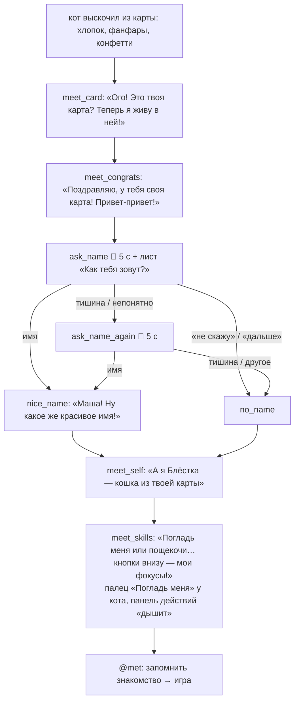
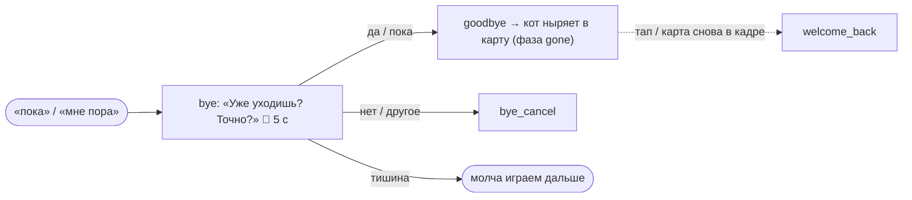
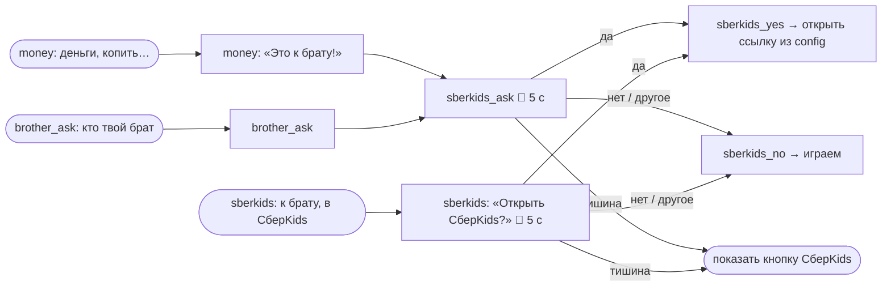
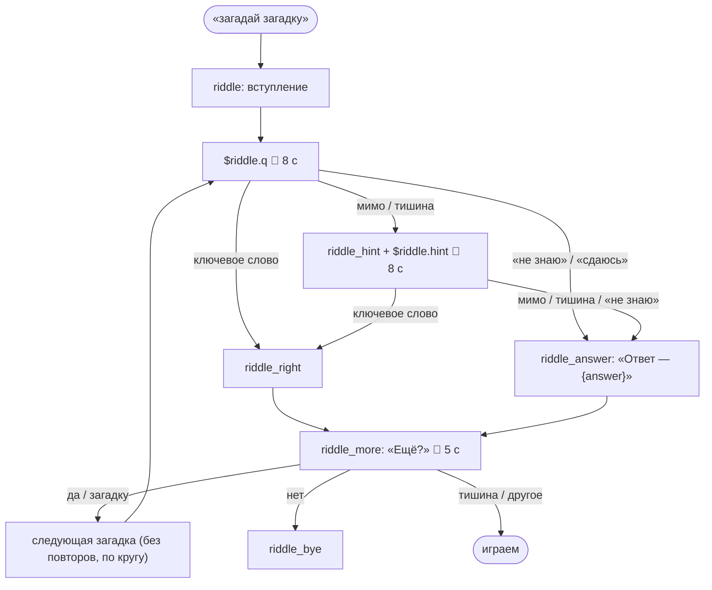
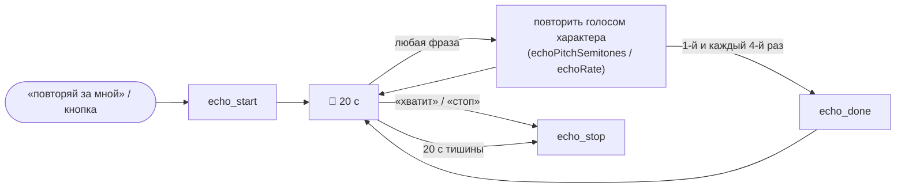
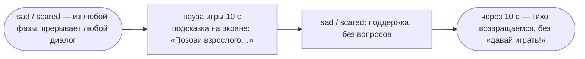

# Диалоги и сценарий сессии

Как кот разговаривает с ребёнком: какие бывают многоходовые диалоги, как устроено окно ответа, по каким правилам выбирается реплика и как идёт сессия. Данные — `content/dialogs.json`, реплики — `content/src/<характер>.lines.txt`, события — `content/events.json`. Код — `src/scenario/dialogs.ts` (движок), `src/scenario/machine.ts` (сессия), `src/persona/` (характер и выбор реплик), `src/director.ts` (исполнение).

## Главное правило: один характер

Выбран характер — всё, что кот говорит и как звучит, берётся только из него. Общих реплик нет.

- `PersonaContext` (`src/persona/context.ts`) знает активный характер. Из него берутся реплики, голос (`piperVoice`, `pitchSemitones`, `rate`, голос «повторялки»), idle-набор с весами, фирменный трюк, `fxTuning`, наклейки, палитра, ambience.
- Реплику выбирает `LinePicker` только из `persona.lines[событие]`. Проверено тестом для всех 93 событий × 3 характеров.
- При смене характера очередь реплик старого характера очищается. Реплика, которая уже звучит, дорезается до конца слога: ждём закрытый рот (визема X/A, не дольше 300 мс), потом `fadeOut(60)`.
- Загадки тоже свои у каждого характера: по 8 штук.

Порядок смены встряской: Хулиган → Добряк → Блёстка → Хулиган. Голосом можно выбрать сразу нужный характер («будь добряком»). Последний выбранный характер запоминается в `localStorage`.

## Окно ответа

Кот задаёт вопрос, и микрофон открывается сам, когда кот договорил (ждём, пока опустеет очередь реплик). Окно длится `answerWindowMs` = 5 с, для загадок 8 с, для «повторялки» 20 с. Дальше возможны три исхода:

| Что произошло | Ключ в `on` |
|---|---|
| Ребёнок сказал что-то из ожидаемого | id интента (`yes`, `no`, `choose_kind`, `echo_stop`…), `name`, `right` / `wrong` / `giveup` (загадка) |
| Сказал что-то другое | `*` |
| Промолчал всё окно | `timeout` |

- `yes`, `no` и `giveup` («не знаю», «сдаюсь») срабатывают только в окне ответа. Вне вопроса «да» ничего не значит.
- Если таймаут пришёл от старого окна, он игнорируется: у каждого окна свой `token`.
- Ответ, сказанный раньше конца вопроса, тоже засчитывается: узел уже ждёт ответ.
- Если ребёнок посреди диалога сказал то, что запускает другой диалог, а текущий узел этого явно не ждёт («пока» посреди загадки), текущий диалог сменяется новым. Знакомство так не прерывается.
- `sad` и `scared` прерывают что угодно, даже знакомство и паузу (`interrupts`).

## Формат `dialogs.json`

```json
"bye": {
  "start": "ask",
  "nodes": {
    "ask":  { "say": "bye", "listen": { "mode": "intent" }, "on": { "yes": "go", "no": "stay", "timeout": "@end", "*": "stay" } },
    "go":   { "say": "goodbye", "next": "@goodbye" },
    "stay": { "say": "bye_cancel", "next": "@end" }
  }
}
```

| Поле узла | Что делает |
|---|---|
| `do` | действия до реплики: `offer_choice`, `riddle_next`, `pause_play:10000`, `adult_hint`, `echo` |
| `say` | событие или список событий. Реплику выбирают у активного характера. `$riddle.q` и `$riddle.hint` — текст текущей загадки |
| `sayIf` | говорить не каждый раз: `{ "counter": "echo", "first": true, "every": 4 }` |
| `count` | увеличить счётчик диалога |
| `listen` | окно ответа `{ "mode": "intent" \| "name" \| "riddle" \| "echo", "ms"? }` |
| `on` | куда идти по ответу |
| `next` | сразу перейти дальше |

Цель перехода — id узла или `@действие[:арг]`: диалог заканчивается и выполняется действие (`@end`, `@goodbye`, `@open_sberkids`, `@show_kids`, `@choose:kind`, `@choose:default`).

`triggers` связывает интент с диалогом: `"money": "brother:money"` — интент `money` запускает диалог `brother` с узла `money`.

## Схемы

### Первое знакомство (`intro`) — один раз



- Знакомство показывается **один раз**: после `@met` в памяти `met: true`. Дальше при входе — `welcome_back`
  («Маша, привет! Я так рада!») и фирменный трюк без слов; из контекста — только `long_absence`.
- Выбор характера в знакомство не входит (лишний шаг): кот знакомится тем характером, что выбран (по умолчанию первый).
  Сменить — кнопка «Другой кот» или «давай другого».
- Имя произносится и сохраняется, только если оно есть в `content/names.ru.txt` (голосом и из поля ввода).
  `{name}` в репликах — только в начале фразы («{name}! …», «{name}, привет! …»): имя звучит отдельным
  восклицанием, а не склейкой посреди предложения.

### Панель действий

В игре внизу — ряд «конфетных» кнопок с иконкой и подписью: Погладить (`stroke`), Щекотка (`tap_cat_belly`),
Угостить (`treat`), Танец, Сальто, Фокус (трюк характера), Загадка, Наклейка, Повторяй, Другой кот.
Касательные кнопки работают как жест по коту, остальные — как сказанная команда (`Director.action`). Каждая
вызывает реплику, клип и эмоцию. Кнопка подсказок в доке прячет и показывает панель.

**Экран не закрывается сам.** Эффекты на всё стекло (снежный шар, туман, жвачка, конфетти, наклейки) — только сразу
после действия ребёнка и не чаще раза в 10 с; наклеек на стекле не больше трёх; тишина больше не заклеивает экран
сменой образа — кот зовёт поиграть (`silence`, затем `bored`) и показывает панель.

### «Пока?» (`bye`)



### «Хочешь к брату?» (`brother`)



Про деньги кот сам ничего не рассказывает. `build.py` проверяет, что каждая реплика `money` содержит «к брату». Ссылку из голосовой ветки браузер может заблокировать (окно открывается не из жеста). Тогда остаётся кнопка «В СберKids» и подсказка на экране.

### Загадка (`riddle`)



Ответ проверяет `answerMatches` (`src/scenario/intentMatch.ts`) по `keywords` загадки:
- `огур*` — основа с любым окончанием;
- слово без звёздочки длиной от 5 букв засчитывается с окончанием до 3 букв;
- для слов от 5 букв прощается одна ошибка распознавания.

Тест проверяет, что правильный ответ каждой загадки проходит её же ключевые слова.

### Повторялка (`echo`)



В режиме повтора даже «привет» повторяется, а не приветствует. Выйти можно только через `echo_stop`, тишину или безопасность.

### Грустно / страшно (`support`)



Во время паузы касания не вызывают реакций, мысли вслух (`filler`) выключены, игровые интенты игнорируются. Повторное «страшно» снова получает поддержку.

## Выбор реплики

`LinePicker` (`src/persona/picker.ts`) выбирает реплику по таким правилам:

1. Только активный характер.
2. Последние 3 варианта события не повторяются. Если вариантов меньше 4, исключается столько, сколько возможно (n−1).
3. `cooldownMs` из `events.json`: реакция не срабатывает чаще. Реплики сценария и диалогов (`force`) идут без задержки.
4. `{name}` — только если имя есть в словаре. Иначе берутся варианты без имени. Поэтому у `nice_name` и `welcome_back` обязателен хотя бы один вариант без `{name}` (это проверяет `build.py`). `{answer}` — только в `riddle_answer`.
5. Лицо берётся так: `face` из строки, если его нет — `face` события, если нет и его — `emotionToFace[эмоция]` из `face.json`.
6. Очередь (`src/persona/lineQueue.ts`) работает по `priority` из `events.json`:

| priority | Что | Поведение |
|---|---|---|
| 3 | безопасность, потеря карты, спам | перебивает всё, очередь сбрасывается до неё |
| 2 | сценарий, диалоги | встаёт в очередь (до 4), перебивает только фон |
| 1 | реакции на касания и голос | перебивает реакцию, фон и сценарий с `interruptible: true`; иначе отбрасывается (звук и эффект касания всё равно срабатывают) |
| 0 | мысли вслух | только в тишине |

## Сессия

```mermaid
stateDiagram-v2
  [*] --> start
  start --> scanning: «Разбудить кота»
  scanning --> appear: карта найдена
  appear --> ask_name: первое знакомство (один раз) — карта, поздравление, имя, «я — …», как играть
  appear --> play: уже знакомы — [long_absence] + welcome_back + трюк
  ask_name --> play: @met
  play --> switching: «давай другого» / кнопка «Другой кот» / choose_X
  switching --> play: встряска
  play --> free: outro (4–6 мин) / кнопка / outro_request
  play --> gone: «пока» → «да»
  free --> gone
  gone --> appear: тап / карта
```



- **Первая встреча.** `meet_card` → `meet_congrats` → `ask_name` → `nice_name`/`no_name` → `meet_self` → `meet_skills` (обучалка) → игра.
- **Повторный визит** (в памяти `met`). `welcome_back` и трюк без слов, без анкеты. Префикс — только `long_absence`. Варианты контекста (`src/scenario/session.ts`):
  - `long_absence` — не было больше 3 дней;
  - `morning` — первый вход за день, 6:00–11:00;
  - `evening` — 20:00–23:00;
  - `first_time_today` — первый вход за день в другое время.
- **Outro.** Таймер на 4–6 минут ставится при первом входе в игру. Если в этот момент идёт диалог, outro откладывается на 20 с. Без таймера outro можно вызвать событием `outro_request`: `__cat.outro()` или кнопкой во вкладке «Контент».
- **Память** (`localStorage`):
  - имя — только из словаря;
  - было ли первое знакомство (`met`);
  - последний характер;
  - число визитов;
  - время последнего входа.

## Проверка

- `npm test`: тесты `tests/dialogs.test.ts` (все ветки каждого диалога), `tests/persona.test.ts` (изоляция характера, выбор реплик, очередь при смене характера) и `tests/scenario.test.ts`.
- `python3 content/build.py`: ссылки `dialogs.json`, 8 загадок на характер, 3+ варианта на ветку, текстовые проверки.
- В браузере с `?debug` есть вкладка «Контент»: характер → событие → реплика по id, «как диалог», «сказать за ребёнка». Из консоли (и без `?debug`) то же доступно через `window.__cat`:
  - `__cat.say('kind.intro.02')`
  - `__cat.event('riddle', true)`
  - `__cat.persona('glitter')`
  - `__cat.text('мне грустно')`
  - `__cat.outro()`

## Правила реплик (проверяет `build.py`)

- **Длина.** До 8 секунд, считаем ≈14 символов в секунду. Длиннее — предупреждение.
- **Обращение к ребёнку — без рода.** Нельзя «ты пришёл», «ты сама», «готова?», «Видал?», «куда карту дел?», «ты такой».
- **Кот о себе — в своём роде.** Хулиган и Добряк говорят «я рад», Блёстка — «я рада».
- **На `sad` и `scared`.** Ни одного вопроса и обязательно предложить взрослого (мама, папа, взрослый, которому доверяешь). На экране при этом появляется текст-подсказка.
- **Личные данные.** Кот спрашивает только имя, и его можно не говорить. Возраст, адрес, школа, телефон, фамилия запрещены.
- **Деньги.** Только «это к брату». Реплика, где упомянуты деньги без брата или СберKids, даёт предупреждение.
- **Без грубостей и насмешек.** На грубость кот не грубит в ответ и не стыдит, а переводит разговор в игру.
