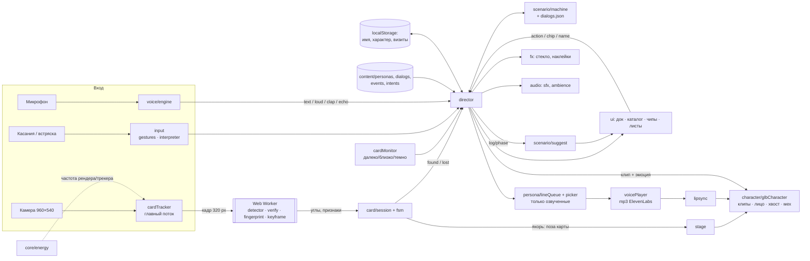
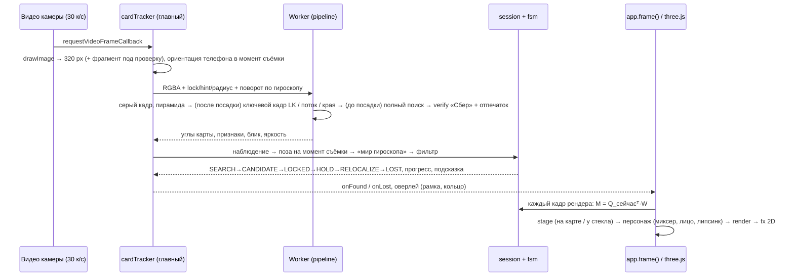
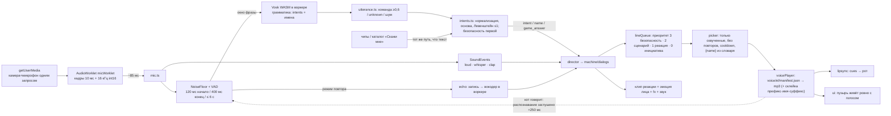
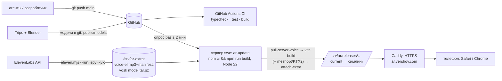
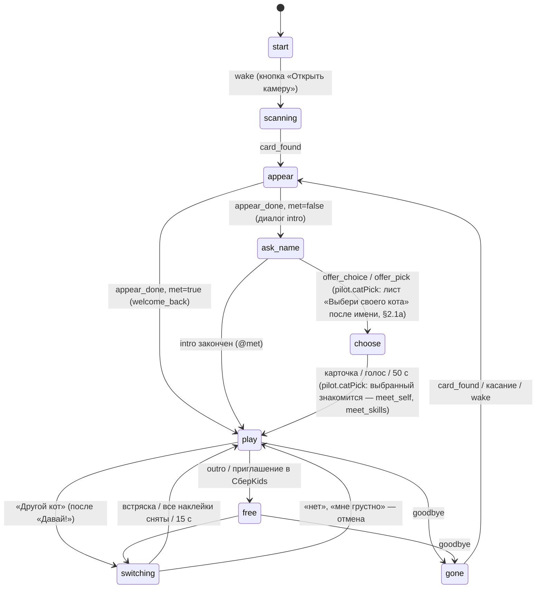
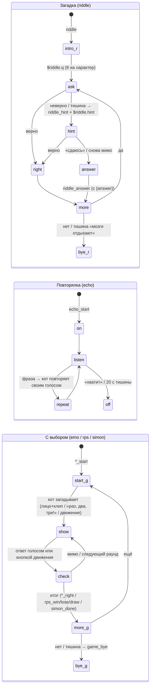

# Карта проекта «AR СберКот» — как есть на 18.11.2026

Инвентаризация прототипа (`main`, коммит `6d967ca` + незакоммиченная работа агента трекера). Код здесь не меняли.
Сайт: https://ar.vershov.com (push в `main` → ~2 мин). Связанные документы: `ARCHITECTURE.md` (частично устарел, см. §7),
`DEPLOY.md`, `VOICE.md`, `scenario/LOGIC.md`, `CARD_DETECTION.md`, `qa/REPORT.md`, `qa/BUGS.md`, `DEVICE_TEST.md`, `REVIEW.md`.
Реплики построчно — [`project/lines_inventory.csv`](project/lines_inventory.csv). Анимации — [`animations/INVENTORY.md`](animations/INVENTORY.md).

**Цифры одной строкой:** 116 TS-модулей в `src/` (≈26,4 тыс. строк), 15 папок-подсистем · 3 характера · 145 событий (+ вопросы загадок) ·
1241 реплика (43,7 тыс. символов), озвучено на сервере 925 (75 %), в озвучке сейчас 316 · 41 событие пока без голоса
(мини-игры с выбором, «Другой кот?», частые вопросы ребёнка) · 45 файлов тестов, 531 тест проходит (5 пропущены — стенды по флагу) ·
QA-стенд 23 шага, ошибок 0.

---

## 1. Архитектура и стек

### 1.1 Модули

| Подсистема | Файлы (шт. / строк) | Что делает | Ключевые файлы |
|---|---|---|---|
| Сборка приложения | `src/main.ts`, `app.ts`, `config.ts`, `stage.ts`, `director.ts` (5 / 2401) | `App` выбирает реализации по URL (`?tracker`, `?char`, `?asr`, `?mic`), связывает модули, цикл кадра; `Stage` ставит кота на якорь; `Director` исполняет команды сценария | `app.ts` (`makeTracker`, `makeCharacter`, `wake()`, `frame()`) |
| core | 7 / 506 | шина событий, часы, энергобюджет (частота рендера/трекера по ситуации: boost/normal/calm/doze), адаптивное качество, карта сжатых моделей | `energy.ts`, `perf.ts`, `modelUrl.ts`, `emitter.ts` |
| tracker | 11 / 1602 | интерфейс `Tracker` + реализации: **card** (по умолчанию, своя), MindAR (`?tracker=mindar`), 8th Wall, WebXR, debug; `cardMonitor` (далеко/близко/темно), сглаживание, удержание по гироскопу | `cardTracker.ts`, `types.ts`, `cardMonitor.ts` |
| tracker/card | 12 / 5096 | автозахват карты Сбера без маркера: детектор четырёхугольника, проверка «карта Сбера» (чип, знак, цвет, оборот), отпечаток 75 дизайнов, ключевой кадр, FSM, поза | `worker.ts`, `pipeline.ts`, `detector.ts`, `verify.ts`, `verifier.ts`, `fingerprint.ts`, `designDb.ts`, `keyframe.ts`, `fsm.ts`, `session.ts`, `geometry.ts`, `overlay.ts` |
| character | 24 / 5145 | `Character`: GLB (по умолчанию), спрайт, риг-заглушка; клипы и смешивание, лицо (блендшейпы, глаза, веки, складки), хвост, мех, реквизит, зоны касания | `glbCharacter.ts`, `animPrep.ts`, `animBlend.ts`, `eyeRig.ts`, `mouthRig.ts`, `tailRig.ts`, `emotions.ts`, `faceLife.ts` |
| voice | 15 / 3242 | «уши» и «рот»: микрофон (AudioWorklet), VAD/громкость, Vosk, интенты, очередь слова, повтор-эхо, проигрыватель реплик | `engine.ts`, `mic.ts`, `micWorklet.ts`, `vad.ts`, `asr.ts`, `intents.ts`, `utterance.ts`, `turn.ts`, `echo*.ts`, `voicePlayer.ts`, `dialog.ts` |
| lipsync | 3 / 493 | виземы A–H/X: готовые cues (espeak-ng), wawa-lipsync по звуку, cues из текста | `lipsync.ts`, `ru.ts`, `visemes.ts` |
| audio | 2 / 604 | Howler: аудиоспрайт sfx, категории, ducking −8 дБ; DSP (вокодер, LUFS) — общий для браузера и Node | `audio.ts`, `dsp.ts` |
| persona | 7 / 709 | загрузка `content/`, «кто сейчас кот», выбор реплики (без повторов, cooldown, строгий режим «только озвученные»), очередь реплик по приоритетам | `content.ts`, `context.ts`, `picker.ts`, `lineQueue.ts`, `runtimeMap.ts` |
| scenario | 9 / 1355 | автомат сессии (чистая функция), движок диалогов `dialogs.json`, лестница тишины, чипы кота, память визитов, контекст входа | `machine.ts`, `dialogs.ts`, `initiative.ts`, `suggest.ts`, `memory.ts`, `actions.ts` |
| ui | 2 TS + CSS / 1214 + 662 | онбординг, док (звук · микрофон · лапка), пузырь, чипы, каталог «Что умею» (7 разделов, 48 пунктов), листы имени/характера/СберKids, меню долгого нажатия | `ui.ts`, `actionCatalog.ts`, `styles.css` |
| fx | 9 / 2774 | 2D-слой «стекло»: 31 эффект (блёстки, жвачка, пар, царапины, конфетти…), наклейки и их отклеивание, эффекты характеров | `fxLayer.ts`, `core.ts`, `stickers.ts`, `effects/{kind,hooligan,glitter,common}.ts` |
| input | 3 / 614 | жесты (тап по зоне, свайп, долгое, двойной, поглаживание, спам, встряска), тишина | `input.ts`, `gestures.ts`, `interpreter.ts` |
| debug | 6 / 649 | `?debug`: панель, вкладки контента/эффектов/голоса, `window.__cat`, `window.__voice` | `debugPanel.ts`, `catApi.ts` |
| content (данные) | `content/` | 145 событий, реплики 3 характеров (`src/*.lines.txt` + `meta.json` → `build.py` → `personas/*.json`), диалоги и 8 загадок на характер, 71 клип, 22+ пресетов лица, 31 эффект, 43 звука, интенты, словарь имён | `events.json`, `dialogs.json`, `intents.ru.json`, `build.py` |
| scripts | `scripts/` | сборка (`build/vite-model-opt.mjs` — meshopt+KTX2), озвучка (`voice/el-batch.mjs`, `eleven.mjs`, `pull-server-voice.mjs`, `attach-extra.mjs`, `piper.mjs`), QA (`qa/run.mjs`), стенды (`bench/`, `scenario/audit.mjs`), модели (`models/*` Blender/Python) | |

### 1.2 Компоненты



### 1.3 Поток кадра (камера → кот)



Частота: энергобюджет — рендер 60/30/20/12 к/с (boost/normal/calm/doze), трекер после посадки 10–15 Гц при неподвижном
телефоне, полная частота при движении/поиске. Воркер (ноутбук): до посадки ≈17 мс/кадр, после ≈6 мс (`CARD_DETECTION.md`).

### 1.4 Поток голоса (микрофон → ответ кота)



Режимы микрофона: по умолчанию «слушаю всегда» (`?mic=ptt` — по кнопке, выбор запоминается). Окно ответа после вопроса кота
открывается само (`answerWindowMs`). Перебивание (barge-in): реплика затухает 120 мс, очередь сценария держится.

### 1.5 Внешние сервисы и деплой

| Сервис | Когда | Что |
|---|---|---|
| **ElevenLabs** (модель `eleven_v4`, 3 голоса по характерам) | офлайн, на сервере swe: `node scripts/voice/eleven.mjs --batch voice-src/el_batch_all.jsonl --run` | mp3 → −16 LUFS → MP3 64k моно + русские cues → `/srv/ar-extra/voice-el` (возобновляемо по хэшу текст+голос+модель). На телефоне — только готовые файлы |
| **Tripo** | офлайн, вручную | 3D-модели котов (скелет Mixamo) и выгрузки движений → Blender-скрипты `scripts/models` (хвост, уши, лицо, мех) → `public/models/*_v1.glb`, `anims_v1.glb` |
| **GitHub** | push в `main` | CI (`.github/workflows/ci.yml`: `npm ci → typecheck → test → build`, без деплоя); сервер раз в 2 мин сам тянет `main` |
| Vosk (alphacephei) | один раз | модель `vosk-model-small-ru-0.22` (~45 МБ) лежит в `/srv/ar-extra`, на телефоне работает офлайн |
| RuStore | ссылка | кнопка «Открыть СберKids» → страница приложения (`ASSETS.sberKidsUrl`) |
| Piper | запасной | старая локальная озвучка (`?piper`), в проде не грузится |

В рантайме приложение в сеть ходит только за своей статикой: видео и голос не покидают телефон.



Откат — переключить симлинк `/srv/ar/current` на прошлый релиз (подробно — `DEPLOY.md`).

### 1.6 Библиотеки (package.json, установленные версии)

| Пакет | Версия | Роль |
|---|---|---|
| three | 0.187.0 (закреплена) | 3D-сцена, GLTFLoader, Draco/KTX2/meshopt |
| mind-ar | 1.2.5 (закреплена) | старый трекер по маркеру, только `?tracker=mindar` |
| howler | 2.2.4 | звуки, разблокировка iOS |
| vosk-browser | 0.0.8 | офлайн-распознавание (Kaldi WASM) |
| wawa-lipsync | 0.0.2 | виземы по звуку (запасной путь) |
| dev: vite 8.3.8, typescript 7.0.2, vitest 5.1.0, puppeteer-core 25.17, jsdom 31, @gltf-transform 4.5, ktx2-encoder 0.6, meshoptimizer 1.3, sharp 0.35, mpg123-decoder 1.0, wasm-media-encoders 0.7, rhubarb-lip-sync-wasm 0.1.8 | | сборка, тесты, QA-стенд, сжатие моделей, обработка озвучки |

Своё вместо библиотек: детектор карты (без OpenCV), липсинк для русского, вокодер, интенты (без LLM и сети).

### 1.7 Размеры загрузки (сборка `dist/` от 18.11 06:09)

| Что | Когда грузится | Размер (сырой / gzip) |
|---|---|---|
| `index.js` (app, director, voice, fx, ui…) + `three.core` + CSS | сразу | 783 / 220 КБ + 245 / 64 КБ + 41 / 9 КБ |
| контент характера (`kind/hooligan/glitter-*.js`), `events-*.js` | сразу (свой характер) | ~65 / 15 КБ каждый, 30 КБ |
| `glbCharacter` (+ Draco/Basis декодеры) | пока ребёнок листает онбординг | 192 / 67 КБ (+ basis wasm 527 КБ, draco ~0,5 МБ по требованию) |
| `cardTracker` + `worker` | при старте трекера | 39 / 14 КБ + 85 / 43 КБ |
| модель кота `models/opt/<характер>.<хэш>.glb` (meshopt + KTX2) | онбординг, высокий приоритет | 3,1–3,2 МБ (исходник 4,2 МБ) |
| библиотека движений `anims_v1.glb` | онбординг | 2,3 МБ |
| реквизит (`props/*.glb`: какао, палочка, зеркало, шар) | по клипу | 0,2–0,36 МБ каждый |
| звуки `sfx.mp3` / `.webm` | после онбординга | 291 / 236 КБ |
| реплики (mp3 64k) | лениво, по событию; LRU-кэш ~12 МБ | ≈ 8 КБ/с звука; всё озвученное — порядка 25–30 МБ (оценка по 47 тыс. символов) |
| Vosk: движок + модель | через 3 с после «Открыть камеру» (не при «экономии трафика»), дальше из IndexedDB | 5,8 МБ / 2,4 МБ + ~45 МБ |
| MindAR, спрайты (`video/sprites` 1,1 МБ), `targets/card.mind` | только в режимах `?tracker=mindar`, `?char=sprite` | 1,05 МБ / 274 КБ … |

До кота на карте при первом визите — ≈ 6 МБ (JS ≈ 0,4 МБ gzip + модель + движения + звуки); Vosk ≈ 47 МБ — фоном.
Весь `dist/` ≈ 40 МБ (с исходными и сжатыми копиями моделей; без голоса и Vosk).

---

## 2. Флоу ребёнка

Источники: `docs/scenario/LOGIC.md`, `src/scenario/machine.ts` (фазы `start → scanning → appear → ask_name/choose → play/free →
switching → gone`), `content/dialogs.json` (диалоги `intro, bye, brother, riddle, echo, switch, offer, emo, rps, simon, support`),
`src/scenario/initiative.ts`, `src/tracker/card/fsm.ts`, `src/ui/ui.ts`, `src/app.ts`.

### 2.1 Сквозной путь

```mermaid
flowchart TD
  A[Ссылка / QR] --> OB1[Онбординг 1/2: «В твоей карте кто-то живёт»<br/>кнопка «Познакомиться», свайп]
  OB1 --> OB2["Онбординг 2/2: «Положи карту на стол и наведи камеру»<br/>«Условия» (лист безопасности)"]
  OB2 -->|«Открыть камеру» — жест iOS| PERM{Разрешения: камера+микрофон одним запросом,<br/>«Движение и ориентация» на iOS}
  PERM -->|отказ камеры| ERR[Экран «Камера не включилась» → «Попробовать снова»]
  PERM -->|ок| SCAN[Поиск карты: «Наведи камеру на карту»<br/>point_camera через 3 с без карты]
  SCAN --> CAND[Кандидат: рамка прилетает к углам, кольцо 0–100 %<br/>подсказки: ближе / дальше / блик / держи ровно / чужая карта / оборот]
  CAND -->|карта Сбера по знаку или отпечатку + стабильно ≈0,35 с| LAND[Посадка: «чавк → хлоп», кот выпрыгивает]
  LAND -->|новый ребёнок| MEET[Знакомство intro: meet_card + meet_congrats → ask_name<br/>имя голосом/полем/«Пропустить» → nice_name/no_name → meet_self → meet_skills + обучалка «Погладь меня»]
  LAND -->|уже знакомы| BACK[welcome_back или long_absence + фирменный трюк молча]
  MEET -->|met=true в localStorage| PLAY
  BACK --> PLAY
  PLAY[Свободная игра:<br/>касания, док, каталог, чипы, голос] <--> GAMES[Мини-игры: загадка, повторялка, угадай эмоцию,<br/>камень-ножницы-бумага, повтори движение]
  PLAY -->|тишина| LADDER[Лестница тишины: 12 с «ты тут?» → 30 с предложение → 55 с мысль → 80 с предложение]
  LADDER -->|110 с| DOZE[Дрёма: Zzz, энергия doze]
  DOZE -->|касание: «А? Я не спал!» / кнопка / фраза — сразу выполняется| PLAY
  LADDER -->|действие ребёнка| PLAY
  PLAY -->|«Другой кот» кнопкой/чипом (MVP; пилот и lab — лист «Позвать другого кота», §2.1а)| ASK[switch_ask: «Давай!» / «Не надо», 8 с]
  ASK -->|да / голосом «давай другого» — сразу| SW[Экран заклеен наклейками → встряска / кнопка «Сдёрнуть» / отклеить все / 15 с сами → новый образ hooligan→kind→glitter]
  ASK -->|нет / тишина| PLAY
  SW --> PLAY
  PLAY -->|карты нет: HOLD 0,3 с → RELOCALIZE 1,5 с → LOST 6 с, +1,5 с| LOST[«Где карта?» — лестница на паузе]
  LOST -->|та же карта найдена| FOUND[card_found «вот она» → игра]
  FOUND --> PLAY
  PLAY -->|4–6 мин, только в тишине| KIDS["invite → зов в СберKids: да → лист «Открыть СберKids» (RuStore)"]
  PLAY -->|«пока»| BYE["bye: «Уже уходишь?» → да → goodbye, кот ныряет в карту (gone) / нет → остаёмся"]
  BYE --> GONE[gone: карта/касание → кот снова выпрыгивает]
  GONE --> PLAY
```

### 2.1а Персонажи: выбор кота и предмет появления (26.11, пилот `/mvp` и lab)

Продакт 26.11: «у нас три **разных** персонажа» — не «кот бывает разным», а «выбери, кто будет с тобой». Флаги
`pilot.catPick` (пилот) и `cat.attrs` (пилот и lab) — `src/config/edition.ts`; в MVP и lab без `pilot.catPick` — прежнее знакомство и
смена наклейками.

```mermaid
flowchart TD
  NAME[«Как тебя зовут?» → имя / «Пропустить» → nice_name / no_name] --> PICK["Пузырь кота из карты: «Выбери, кто будет с тобой!» (немой, записи нет)<br/>лист «Выбери своего кота»: Хулиган · Добряк · Блёстка"]
  PICK -->|касание карточки / голосом «Добряк»| SWAP[вспышка → прежний кот исчезает →<br/>выбранный выскакивает из карты (короткое пробуждение)]
  PICK -->|2 × 25 с без касания| SELF
  SWAP --> SELF["выбранный знакомится сам: meet_self своим голосом → meet_skills → игра"]
  SWAP --> ATTR[предмет появления: Хулиган — выезд на скейте, Добряк — какао у груди, Блёстка — зеркальце]
  PLAY[игра] -->|«Другой кот» / «давай другого» / «поменяйся»| PICK2["лист «Позвать другого кота»: двое других + «Не сейчас» (15 с)"]
  PICK2 -->|карточка| SWAP2[вспышка → новый кот выскакивает → meet_self → предмет появления]
  PICK2 -->|«Не сейчас» / «нет» / тишина / другая кнопка| PLAY
  PLAY -->|«хочу Блёстку» голосом| SWAP2
  CARD[кот выходит из карты (первая встреча, «с возвращением»)] --> ATTR
```

* Код: `scenario/machine.ts` — `withPick` (узлы `intro.pick / pick_wait / pick_auto` и диалог `pick` поверх `dialogs.json`,
  общий контент не меняется), `pickPersona` (действие `swap_persona`); `director.offerPick` (лист, пузырь),
  `director.swapPersona` (вспышка, смена модели, `awake.play(…, 'short')`), `director.playAttr` (предмет после выхода
  из карты; оркестратор — `appear`, кнопки ждут); `ui.showChoice(…, { title, close })`. Кулдаун пилота (раз в 3 мин)
  проверяется при открытии листа и при выборе.
* Наклеек, встряски и реплик «переодеваюсь / новый я / Добряк? ладно, буду милым» в этом потоке нет: новый кот
  представляется сам (`meet_self`: «А я Добряк — кот из твоей карты»).
* Предмет появления — `config/pilot.ts APPEAR_ATTR` (`null` — кот без предмета). Хулиган — `skate_show`
  (`character/skateTiming.ts SKATE_SHOW_ORDER`: доска из искры под лапами, пока кот подпрыгнул → толчок → проезд дугой →
  докат → соскок → доска уходит искрой; без кикфлипа, олли и подброса доски в лапу). Пилотный «Скейт» в каталоге играет
  тот же `skate_show`. В пробуждении Хулигана больше нет сальто и доски сцены (они и давали «вверх ногами» и «скейт
  вылетает из кота»).
* Хват предметов (`character/gripSolver.ts`): предмет ставится от ладони, затем выталкивается из подушечек вдоль нормали
  ладони по полю расстояний предмета (сетка ~26³, строится один раз), каждый сустав каждого пальца Mixamo
  (Thumb/Index/Middle/Ring/Pinky 1–3) сгибается до касания поверхности — пальцы обхватывают ручку кружки/зеркальца,
  хвост рыбки, палочку пузырей. Замер — `scripts/qa/props-grip.mjs` (листы `props_grip_<кот>.jpg`, отчёт
  `docs/qa/props/GRIP.md`), в аудите анимаций — колонка «пр. предмета».
* Баг 26.11 «сменилась подпись, модель прежняя»: загрузки моделей шли наперегонки — поздняя модель прошлого кота
  ставилась поверх нового (`app.ts setCharacterMode`, теперь номер запроса `charGen`).

### 2.2 Автомат сессии (фазы `machine.ts`)



Внутри `play/free` живут диалоги и мини-игры (`state.dialog`, `state.game`) и лестница тишины (вне автомата — `initiative.ts`).
Трекер — отдельная FSM: `SEARCH → CANDIDATE → LOCKED → HOLD → RELOCALIZE → LOST` (`fsm.ts`).

### 2.3 Мини-игры и диалоги



Правила (`LOGIC.md`): касания в мини-игре — клип и эмоция без слов; любая кнопка-команда кончает игру и выполняется
(в «повтори движение» кнопка движения — ответ); «мне грустно/страшно» прерывает всё (приоритет 3, 10 с без предложений,
но действие ребёнка паузу снимает). Предложения по кругу: загадка → КНБ → повторялка → эмоция → танец → движение
(неозвученные пропускаются — сейчас КНБ, эмоция и движение пропускаются и **скрыты в каталоге**: `app.voicedOnly`).

### 2.4 Точки контакта

| Канал | Что есть | Где в коде |
|---|---|---|
| Экраны | онбординг 2 шага + «Условия», ошибка камеры, оверлей карты (рамка, кольцо, подсказки), пузырь реплики (над/сбоку от головы, живёт с голосом), Zzz, листы «Как тебя зовут?», «Каким мне быть?», «Брат живёт в СберKids» | `ui.ts`, `card/overlay.ts` |
| Кнопки дока (всегда видны после онбординга) | звук вкл/выкл · микрофон (слушает всегда / держи-и-говори, «ушки» пока слушает) · лапка «Что умею» (бледная до конца знакомства) | `ui.ts` `.dock` |
| Каталог «Что умею» | 7 разделов / 48 пунктов: Забота (погладить, почесать, щекотка, щёчки, лапа, угостить, обнять), Трюки (сальто, танец, фокус, прыжок, сидеть, помаши, песенка), Игры, Эмоции, Чудеса (пузыри, рисунок, стекло, стук, наклейки…), Скажи мне (фразы), Ещё (пересадить, другой кот…) | `actionCatalog.ts`, `scenario/actions.ts` |
| Чипы кота | ≤ 2 над доком, по событиям режиссёра: «Сдаюсь», «Хватит», «Давай!/Не надо», «Разбуди меня», ответы игр, непробованное из каталога; подсказка `help` голосом через 8 с тишины (первые визиты) или палец на чипе | `scenario/suggest.ts`, `app.kickSuggest` |
| Жесты | тап по зоне кота (голова, щека, живот, лапа, хвост), тап мимо (стук по стеклу), двойной тап, поглаживание / долгое, три тычка, сильный тычок, свайп (царапины/шлейф), долгое нажатие 0,6 с → меню «Пересадить на другую карту», спам, встряска, отклеивание наклеек, рисование на запотевшем стекле | `input/*`, `fx/*` |
| Голос | 44 события-интента (`intents.ru.json`): привет/пока/да/нет, имя, команды трюков, «мне грустно/страшно», деньги → брат в СберKids, загадка, шутка, повторялка, игры; громкость: крик, шёпот, хлопок | `voice/intents.ts`, `vad.ts` |
| Камера/карта | point_camera, card_found/lost, card_far/close, low_light | `cardTracker`, `cardMonitor` |
| Время/контекст | morning, evening, long_absence (> 3 дней), first_time_today; лестница тишины; зов в СберKids на 4–6 мин | `scenario/session.ts`, `initiative.ts` |
| Память | localStorage: имя (только из словаря), характер, визиты, время входа, `met` | `scenario/memory.ts` |

---

## 3. Реплики кота

Источник истины — `content/src/<характер>.lines.txt` → `content/build.py` → `content/personas/*.json` и `gen/voice_lines.csv`
(сверено: пересборка в копии даёт те же файлы; 1193 реплики + 48 строк загадок). Пакет озвучки `voice-src/el_batch_all.jsonl`
собирается из CSV (`scripts/voice/el-common.mjs → buildJobs`) — сверено: 1919 заданий, ни одного расхождения по id и хэшу.
Все дельты (17.11, 17.11-logic, 18.11) — подмножества `el_batch_all`.

**Правило статуса:** «озвучено» = задание есть в `el_batch_all` и его нет в последней дельте `el_batch_delta_2026-11-18.jsonl`
и это не `switch_ask` (их озвучивают сейчас). Реплика со слотом `{name}` озвучена, если озвучены её куски `~a/~b`;
с `{answer}` — если озвучены все варианты `@r01…r08`. На сайте работает строгий режим: неозвученная реплика не выбирается и
пузырь не показывается — событие без единой озвученной реплики идёт молча (клип и эмоция остаются).

### 3.1 Итоги

| | реплик (строк контента) | символов | озвучено | в работе | заданий ElevenLabs | символов в заданиях |
|---|---|---|---|---|---|---|
| всего | **1241** | **43 676** | **925 (75 %)** | **316** (310 дельта 18.11 + 6 `switch_ask`) | 1919 | 61 776 (с пометками интонации) |
| озвучено | | 32 390 | | | 1603 | 47 279 |
| в работе | | 11 286 | | | 316 | 14 497 |
| Хулиган / Добряк / Блёстка | 420 / 405 / 416 | | 319 / 297 / 309 | 101 / 108 / 107 | 646 / 631 / 642 | |

Задания сверх реплик: 597 слотов (имена из `names.ru.txt` и ответы загадок, по каждому характеру), 37 кусков `~a/~b`
вокруг `{name}`, варианты `{answer}` × 8 загадок.

| Группа событий | событий | реплик | озвучено | в работе | символов |
|---|---|---|---|---|---|
| сценарий | 20 | 197 | 189 | 8 | 8 159 |
| касания/карта/время | 30 | 304 | 248 | 56 | 9 881 |
| голос ребёнка | 44 | 368 | 293 | 75 | 13 612 |
| контекст входа | 4 | 30 | 30 | 0 | 1 119 |
| диалоги | 16 | 168 | 141 | 27 | 5 406 |
| мини-игры с выбором | 31 | 150 | 0 | 150 | 4 276 |
| загадки (вопросы) | 1 | 24 | 24 | 0 | 1 223 |

### 3.2 События без голоса сейчас (41 из 146)

Ни одной озвученной реплики ни у одного характера — на сайте кот здесь молчит (клип/эмоция есть):
- **«Другой кот?»** — `switch_ask` (вопрос идёт только чипами «Давай!» / «Не надо»);
- **частые вопросы ребёнка** — `where_live`, `likes`, `friends`, `friend`, `tale`, `how_are_you`;
- **предложения новых игр** — `offer_emo`, `offer_rps`, `offer_simon` (в круге предложений пропускаются);
- **все мини-игры с выбором** — `emo_*` (10), `rps_*` (9), `simon_*` (10), `game_more`, `game_bye` (игры скрыты в каталоге, пока
  не озвучено `*_start`).

Частично (часть вариантов в дельте 18.11, событие звучит озвученными): `ask_name`, `nice_name`, `tap_cat`, `tap_cat_head`,
`tap_cat_belly`, `tap_cat_paw`, `tap_cat_tail`, `stroke`, `stroke_long`, `double_tap`, `treat`, `no`, `name_ask`, `flip`, `jump`, `dance`.
Голос ребёнка в повторялке (`echo`) — не реплика: кот проигрывает запись ребёнка.

### 3.3 По событиям × характер

Ячейка — «вариантов / озвучено (+ в работе)». Пример — первый вариант Хулигана / Блёстки. Построчно — `project/lines_inventory.csv`
(колонки: событие, группа, характер, id, эмоция, текст, символов, озвучено да/нет, статус).

**сценарий** (20 событий)

| событие | Хулиган | Добряк | Блёстка | без голоса сейчас? | пример (Хулиган / Блёстка) |
|---|---|---|---|---|---|
| `point_camera` | 4/4 | 3/3 | 3/3 |  | Эй, я тут, в карте! Наведи на неё камеру. / Ау! Я в карте! Наведи на неё камеру — будет красиво. |
| `intro` | 3/3 | 3/3 | 3/3 |  | Опа! Свет, камера, я! Йо, привет! / Та-дам! Привет! Ой, какая встреча! |
| `meet_card` | 3/3 | 3/3 | 3/3 |  | Опа! Это твоя карта? Всё, теперь я живу в ней! / Ого! Это твоя карта? Теперь я живу в ней! |
| `meet_congrats` | 3/3 | 3/3 | 3/3 |  | Поздравляю! Своя карта — это круто. Привет! / Поздравляю, у тебя своя карта! Привет-привет! |
| `meet_self` | 3/3 | 3/3 | 3/3 |  | А я Хулиган — кот из твоей карты. / А я Блёстка — кошка из твоей карты. |
| `meet_skills` | 3/3 | 3/3 | 3/3 |  | Погладь меня пальцем или пощекочи живот. А кнопки внизу — мои трюки! / Погладь меня пальцем или пощекочи животик. А кнопки внизу — мои фокус… |
| `ask_name` | 3/3 | 3/2 (+1) | 3/3 | частично | Как тебя зовут? Можешь не говорить, я не обижусь. / Как тебя зовут? Мне очень-очень интересно. |
| `nice_name` | 6/6 | 5/5 | 5/4 (+1) | частично | {name}? Норм имя. Запомню. / {name}! Ну какое же красивое имя! |
| `no_name` | 3/3 | 3/3 | 3/3 |  | Ладно, тайный агент. Уважаю. / Секрет? Обожаю секреты! |
| `mic_hint` | 3/3 | 3/3 | 3/3 |  | Жми кнопку с микрофоном и говори. Я слушаю. / Нажми на микрофон внизу — и у нас будет интервью! |
| `choose` | 3/3 | 3/3 | 3/3 |  | У меня три образа. Тыкай в наклейку — переоденусь. / Выбирай, какой мне быть! Хулиган, Добряк или я — Блёстка! |
| `invite` | 3/3 | 3/3 | 3/3 |  | Тыкай в меня, стучи по экрану. Или тряхни телефон, если не боишься. / Проведи пальцем по экрану — будет блестящий след! |
| `switch_ask` | 2/0 (+2) | 2/0 (+2) | 2/0 (+2) | **да** | Сменить прикид? Скажи «давай» или «не надо». / Переодеться в новый образ? Скажи «давай»! |
| `switch_start` | 3/3 | 3/3 | 3/3 |  | Ща переоденусь, не подглядывай! / Минутку, я переодеваюсь! Не подглядывать! |
| `shake_prompt` | 3/3 | 2/2 | 2/2 |  | Тряхни — и увидишь нового меня. / Теперь встряхни! Посильнее! |
| `hello_new` | 3/3 | 3/3 | 3/3 |  | Ну как тебе? Новый я! / Та-дам! Ну как я? |
| `filler` | 6/6 | 5/5 | 6/6 |  | Эх... скейт бы сейчас. И рампу. / Ля-ля-ля... Интересно, мне пойдёт розовая кепка? |
| `outro` | 3/3 | 3/3 | 3/3 |  | Дальше — у меня дома, в СберKids. Там брат. Кнопка внизу. / Пойдём ко мне домой, в СберKids! Там брат и куча всего интересного. |
| `welcome_back` | 5/5 | 5/5 | 5/5 |  | {name}! Снова ты. Я как раз заскучал. / {name}! Ты тут! Я сияю! |
| `goodbye` | 3/3 | 3/3 | 3/3 |  | Давай, до связи! Карту не теряй. / Пока-пока! Лови воздушный поцелуй. С блёстками! |

**касания/карта/время** (30 событий)

| событие | Хулиган | Добряк | Блёстка | без голоса сейчас? | пример (Хулиган / Блёстка) |
|---|---|---|---|---|---|
| `tap_cat` | 5/4 (+1) | 4/3 (+1) | 4/4 | частично | Эй, щекотно! / Ой! Осторожно, я при параде. |
| `tap_cat_head` | 5/3 (+2) | 5/2 (+3) | 5/2 (+3) | частично | Э, кепку помнёшь! / Ой, бантик! Аккуратно, я его час поправляла. |
| `tap_cat_cheek` | 3/3 | 2/2 | 2/2 |  | Чё, щёку мнёшь? Да, пушистая. Знаю. / Хи-хи, щёчки! Они мягкие, правда? |
| `tap_cat_belly` | 5/3 (+2) | 5/2 (+3) | 5/2 (+3) | частично | Ха-ха, не-не-не, только не живот! / Ой-ой-ой, щекотно! Хи-хи-хи! |
| `tap_cat_paw` | 5/3 (+2) | 5/2 (+3) | 5/2 (+3) | частично | Дай пять! А, это просто тык. / Лапка! Видишь, у меня маникюр с блёстками. |
| `tap_cat_tail` | 5/3 (+2) | 5/2 (+3) | 5/2 (+3) | частично | Ай, хвост! Он чувствительный! / Ай, хвостик! Он у меня с блёстками, не стряхни! |
| `poke_combo` | 3/3 | 2/2 | 2/2 |  | Три раза в одно место? Серьёзно? / Ну всё, я обиделась! На одну секундочку. |
| `poke_hard` | 3/3 | 2/2 | 2/2 |  | Воу! Это было резко. / Ой! Я же хрупкая, как ёлочная игрушка! |
| `stroke` | 5/3 (+2) | 5/3 (+2) | 5/3 (+2) | частично | Мурр... ладно, так можно. / Мурр... Обожаю! |
| `stroke_long` | 4/3 (+1) | 5/3 (+2) | 4/3 (+1) | частично | Ну всё, меня приручили. Это секрет. / Мурр... Можно так всегда? |
| `tap_screen` | 5/5 | 4/4 | 5/5 |  | Тук-тук, чё надо? / Пуф — блёстки! |
| `double_tap` | 5/3 (+2) | 5/3 (+2) | 5/3 (+2) | частично | Смотри, чё умею! / Лови блёстки! |
| `walk_to` | 4/4 | 3/3 | 3/3 |  | Иду-иду. / Иду, как по подиуму. |
| `swipe` | 4/4 | 3/3 | 4/4 |  | Хе, когти — во! / Блестящий след! Нарисуй что-нибудь. |
| `longpress` | 3/3 | 3/3 | 3/3 |  | Чё, держишь меня? Я не убегу. / Чмок! Это тебе. |
| `treat` | 5/3 (+2) | 5/3 (+2) | 5/3 (+2) | частично | Ням! Рыбка — топ. Спасибо! / Ням! Рыбка с блёстками? Шучу. Вкусно! |
| `shake` | 3/3 | 3/3 | 4/4 |  | Эй, я так укачаюсь! / Ах! Снежный шар! Как красиво! |
| `spam` | 3/3 | 3/3 | 3/3 |  | Стоп-стоп-стоп! Пальцы не устали? / Ой-ой-ой, у меня голова кружится! Стоп! |
| `silence` | 4/4 | 3/3 | 4/4 |  | Скукота... Спорим, ты не тыкнешь в меня? / Ау? Ты тут? Я тут красивая стою. |
| `sleep` | 2/2 | 2/2 | 2/2 |  | Ладно... я... чуть-чуть... посплю... / Пойду посмотрю красивый сон... |
| `wake_up` | 3/3 | 2/2 | 2/2 |  | А? Чё? Я не спал! Я думал. / Ой! Я спала? Я не спала! Я отдыхала глазами. |
| `sticker_peel` | 3/3 | 3/3 | 4/4 |  | Эй, это моя наклейка! / Аккуратненько! Вот так. |
| `stickers_all_gone` | 2/2 | 2/2 | 2/2 |  | Все наклейки сняты? Без встряски? Уважаю. / Все! До одной! Это было красиво. |
| `card_lost` | 3/3 | 3/3 | 3/3 |  | Эй, куда карта делась? / Ой, а где карта? Мне без неё не на чем стоять. |
| `card_found` | 3/3 | 3/3 | 4/4 |  | О, карта вернулась! / Ура! Нашлась! |
| `card_far` | 2/2 | 2/2 | 2/2 |  | Ты где? Поднеси карту поближе. / Ты так далеко! Мне нужен крупный план. |
| `card_close` | 2/2 | 2/2 | 2/2 |  | Воу, слишком близко! Отодвинь чуток. / Ой, слишком близко! У меня носик в экран упирается. |
| `low_light` | 2/2 | 2/2 | 2/2 |  | Темновато. Включи свет — хочу тебя видеть. / Темно... блёстки не сверкают. Включи свет! |
| `surprise` | 2/2 | 2/2 | 2/2 |  | Ого! Вот это сюрприз. Я аж кепку уронил. / Ах! Вот это сюрприз! У меня даже блёстки подпрыгнули. |
| `tease` | 2/2 | 2/2 | 2/2 |  | Дразнишься? Я тоже умею: бе-бе-бе! / Дразнишься? А я всё равно самая блестящая! |

**голос ребёнка** (44 событий)

| событие | Хулиган | Добряк | Блёстка | без голоса сейчас? | пример (Хулиган / Блёстка) |
|---|---|---|---|---|---|
| `hello` | 3/3 | 3/3 | 4/4 |  | Салют! / Приветик! |
| `bye` | 3/3 | 3/3 | 3/3 |  | Уже уходишь? Точно? / Уже? Ну нет... Точно уходишь? |
| `yes` | 3/3 | 3/3 | 3/3 |  | Вот и я говорю! / Ура! |
| `no` | 3/3 | 3/3 | 3/1 (+2) | частично | Не хочешь — как хочешь. / Ладно, блёстки подождут. |
| `skip` | 3/3 | 2/2 | 2/2 |  | Ладно, дальше. / Дальше так дальше. |
| `unknown` | 4/4 | 3/3 | 4/4 |  | Чё? Не расслышал. / Ой, я не расслышала. Скажи ещё раз? |
| `name_ask` | 3/1 (+2) | 3/0 (+3) | 3/2 (+1) | частично | Я брат СберКота. Близнец. Только поинтереснее. / Я Блёстка! Сестра-близняшка СберКота. Самая блестящая в семье. |
| `age_ask` | 3/3 | 2/2 | 2/2 |  | Столько же, сколько брату. Мы же близнецы. / Мы с братом одного возраста. Мы же близнецы! |
| `brother_ask` | 2/2 | 2/2 | 2/2 |  | Мой брат — СберКот. Живёт в СберKids и про деньги всё знает. / Мой брат — СберКот. Он очень умный и живёт в СберKids. |
| `money` | 3/3 | 3/3 | 3/3 |  | Это к брату! Он про деньги всё знает. / Про деньги — это к брату! Он у нас умный. |
| `sberkids` | 3/3 | 3/3 | 3/3 |  | К брату? Йо! Открыть СберKids? / К брату? Ура! Открыть СберKids? |
| `flip` | 5/3 (+2) | 5/3 (+2) | 6/4 (+2) | частично | Смотри внимательно! / Оп-ля! С блёстками! |
| `jump` | 3/3 | 3/3 | 3/2 (+1) | частично | Оп! / Прыг! |
| `dance` | 5/3 (+2) | 5/3 (+2) | 5/3 (+2) | частично | Диджей, музыку! / Танцуем! Кружимся! |
| `sit` | 2/2 | 2/2 | 2/2 |  | Сижу. Только недолго, я непоседа. / Села. Красиво сижу? |
| `wave` | 2/2 | 2/2 | 2/2 |  | Йо-йо! Это я машу. / Машу! Видишь блёстки с лапки? |
| `sing` | 2/2 | 2/2 | 2/2 |  | Йо, я кот, я на скейте, лучше всех на этом свете! Всё, концерт оконче… / Блёстки, блёстки, ярче всех, у меня большой успех! Ой, как хорошо пол… |
| `gum` | 3/3 | 3/3 | 3/3 |  | Трюк? Легко. Смотри! / Трюк? Внимание... облако блёсток! |
| `stickers` | 2/2 | 2/2 | 2/2 |  | Наклейки? Держи! Отклеивай за уголок. / Наклейки! Наклони телефон — они переливаются. |
| `change_persona` | 2/2 | 2/2 | 2/2 |  | Хочешь другого меня? Ладно, переодеваюсь. / Другой образ? Обожаю переодеваться! |
| `choose_hooligan` | 2/2 | 1/1 | 1/1 |  | Хулиган? Правильный выбор! / Хулиган? Ну ладно, братишка у нас дерзкий. Сейчас! |
| `choose_kind` | 1/1 | 2/2 | 1/1 |  | Добряк? Ладно, буду милым. Попробую. / Добряк! Он очень милый. Превращаюсь! |
| `choose_glitter` | 1/1 | 1/1 | 2/2 |  | Блёстка? Сестрёнка вредная, но классная. Ща! / Блёстка! Ура! Я знала! |
| `compliment` | 3/3 | 3/3 | 3/3 |  | Ну... ты тоже ничего. Ладно, с тобой классно. / Ой, спасибо! С тобой тоже очень классно! |
| `rude` | 3/3 | 3/3 | 3/3 |  | Так говорить не круто. Давай лучше трюк покажу. / Ой. Это было обидно. Давай лучше дружить? |
| `sad` | 3/3 | 3/3 | 3/3 |  | Эй, грустно бывает. Я рядом. Расскажи маме или папе, они поймут. / Ой, мне так жаль. Я рядом. Расскажи маме или папе — они помогут. |
| `scared` | 3/3 | 3/3 | 3/3 |  | Страшно бывает даже крутым. Позови взрослого, пусть побудет рядом. / Я с тобой. Позови кого-нибудь из взрослых, пусть будут рядом. |
| `bored` | 3/3 | 3/3 | 3/3 |  | Скучно? Скажи «повторяй за мной». Будет весело, отвечаю. / Тряхни телефон — будет снежный шар! |
| `riddle` | 3/3 | 3/3 | 3/3 |  | Загадку? Ща, слушай. / Загадку? Обожаю! Слушай. |
| `joke` | 3/3 | 3/3 | 5/5 |  | Почему кот сидит у компьютера? Следит за мышкой! Хе-хе. / Почему у меня столько блёсток? Я чихнула в коробку с ними! Хи-хи. |
| `help` | 3/3 | 3/3 | 3/3 |  | Погладь меня, тыкни в живот или жми кнопки внизу. А ещё скажи «сальто… / Погладь меня, пощекочи или жми кнопки внизу. Скажи «танцуй»! |
| `thanks` | 3/3 | 3/3 | 3/3 |  | Да не за что! / Для тебя — всегда! |
| `echo_start` | 3/3 | 3/3 | 3/3 |  | Давай, говори. Я повторю. / Говори! Я повторю! |
| `echo_done` | 3/3 | 3/3 | 3/3 |  | Похоже? Я ещё и не так могу. / Хи-хи, похоже? |
| `echo_stop` | 3/3 | 3/3 | 3/3 |  | Всё, режим попугая выключен. / Всё, повторялка ушла на перерыв. |
| `loud` | 2/2 | 2/2 | 2/2 |  | Ай, уши! Не кричи, я рядом. / А-а-ай, громко! У меня ушки! |
| `whisper` | 2/2 | 2/2 | 2/2 |  | Чё, шепчем? Ладно, это наш секрет. / Ш-ш-ш... это наш секрет. Я никому. |
| `clap` | 2/2 | 2/2 | 2/2 |  | Ой! Кто хлопнул? Я аж подпрыгнул. / Ой! Я аж подпрыгнула. Это мне хлопают? |
| `where_live` | 3/0 (+3) | 3/0 (+3) | 3/0 (+3) | **да** | В твоей карте! А в СберKids живёт мой брат. / В твоей карте! Это мой блестящий домик. |
| `likes` | 3/0 (+3) | 3/0 (+3) | 3/0 (+3) | **да** | Скейт, граффити и жвачку. И с тобой тусить. / Блёстки, наряды и звёзды! |
| `friends` | 3/0 (+3) | 3/0 (+3) | 3/0 (+3) | **да** | Конечно! Ты, например. / Конечно! Ты, например. Моя звёздочка! |
| `tale` | 3/0 (+3) | 3/0 (+3) | 3/0 (+3) | **да** | Жил-был кот на скейте. Катался, катался и докатился до твоей карты. Т… / Жила-была звёздочка. Она упала в коробку с блёстками и стала сиять ещ… |
| `friend` | 3/0 (+3) | 3/0 (+3) | 3/0 (+3) | **да** | Дружить? Давай! Ты теперь в моей банде. / Давай! Теперь ты мой лучший друг. |
| `how_are_you` | 3/0 (+3) | 3/0 (+3) | 3/0 (+3) | **да** | Норм! Даже отлично, раз ты тут. / Сияю! А с тобой ещё ярче. |

**контекст входа** (4 событий)

| событие | Хулиган | Добряк | Блёстка | без голоса сейчас? | пример (Хулиган / Блёстка) |
|---|---|---|---|---|---|
| `morning` | 3/3 | 3/3 | 3/3 |  | Доброе утро! Зубы уже чищены? Мои — почти. / Доброе утро! Я уже причесала ушки. |
| `evening` | 2/2 | 2/2 | 2/2 |  | Уже вечер... Скоро спать. Но пару трюков успеем. / Уже вечер... скоро красивые сны. |
| `long_absence` | 2/2 | 2/2 | 2/2 |  | Где пропадаешь? Я тут скучал, между прочим! / Тебя так долго не было! Я скучала. |
| `first_time_today` | 3/3 | 3/3 | 3/3 |  | О, первый заход за день. Погнали! / Первый раз сегодня! Привет-привет! |

**диалоги** (16 событий)

| событие | Хулиган | Добряк | Блёстка | без голоса сейчас? | пример (Хулиган / Блёстка) |
|---|---|---|---|---|---|
| `offer_riddle` | 3/3 | 3/3 | 3/3 |  | Слушай, загадку хочешь? Скажи «да». / Хочешь загадку? Она очень красивая! Скажи «да». |
| `offer_echo` | 3/3 | 3/3 | 3/3 |  | Давай в повторялку? Ты говоришь — я повторяю. Играем? / Поиграем в повторялку? Скажи что-нибудь — я повторю! |
| `offer_dance` | 3/3 | 3/3 | 3/3 |  | Показать, как я танцую? Скажи «да». / Показать мой танец? Скажи «да»! |
| `ask_name_again` | 3/3 | 3/3 | 3/3 |  | Не расслышал. Скажи имя ещё раз — или «дальше». / Ой, я не расслышала. Скажи имя ещё раз? Или «дальше». |
| `sberkids_ask` | 3/3 | 3/3 | 3/3 |  | Хочешь к брату в СберKids? Да или нет? / Пойдём к брату в СберKids? |
| `sberkids_yes` | 3/3 | 3/3 | 3/3 |  | Погнали! Открываю СберKids. / Ура! Открываю СберKids! |
| `sberkids_no` | 3/3 | 3/3 | 3/3 |  | Окей, играем дальше. / Ладно, остаёмся тут. |
| `bye_cancel` | 3/3 | 3/3 | 3/3 |  | Остаёмся? Йо, отлично! / Ура! Остаёмся! |
| `riddle_hint` | 11/11 | 11/11 | 11/11 |  | Не-а. Подсказка: / Не-а! Подсказка: |
| `riddle_right` | 3/3 | 3/3 | 3/3 |  | В точку! Респект. / Ура! Правильно! |
| `riddle_answer` | 3/3 | 3/3 | 3/3 |  | Ответ — {answer}. Ничего, в следующий раз. / Та-дам, это {answer}! Хитренькая, правда? |
| `riddle_more` | 3/3 | 3/3 | 3/3 |  | Ещё одну? / Ещё одну загадочку? |
| `riddle_bye` | 3/3 | 3/3 | 3/3 |  | Ладно, загадки потом. / Загадки уходят на антракт. |
| `offer_emo` | 3/0 (+3) | 3/0 (+3) | 3/0 (+3) | **да** | Хочешь, скорчу рожицу, а ты угадаешь, какой я? / Хочешь, я покажу настроение, а ты угадаешь? |
| `offer_rps` | 3/0 (+3) | 3/0 (+3) | 3/0 (+3) | **да** | Сыграем в камень, ножницы, бумагу? / Сыграем в камень, ножницы, бумагу? Скажи «да»! |
| `offer_simon` | 3/0 (+3) | 3/0 (+3) | 3/0 (+3) | **да** | Повторишь мои движения? Спорим, нет? / Давай я покажу движение, а ты повторишь? Как на подиуме! |

**мини-игры с выбором** (31 событий)

| событие | Хулиган | Добряк | Блёстка | без голоса сейчас? | пример (Хулиган / Блёстка) |
|---|---|---|---|---|---|
| `emo_start` | 2/0 (+2) | 2/0 (+2) | 2/0 (+2) | **да** | Играем! Я корчу рожицу, а ты угадываешь, какой я. / Играем! Я показываю настроение, а ты угадываешь, какая я. |
| `emo_ask` | 2/0 (+2) | 2/0 (+2) | 2/0 (+2) | **да** | Ну, какой я сейчас? / Какая я сейчас? |
| `emo_wrong` | 2/0 (+2) | 2/0 (+2) | 2/0 (+2) | **да** | Не-а. Смотри ещё раз, внимательно. / Не-а! Смотри ещё разок. |
| `emo_right` | 2/0 (+2) | 2/0 (+2) | 2/0 (+2) | **да** | В точку! Читаешь меня, как комикс. / Угадано! Блестяще! |
| `emo_is_happy` | 1/0 (+1) | 1/0 (+1) | 1/0 (+1) | **да** | Это был весёлый я! Ну, как обычно. / Это я радовалась! Сияю! |
| `emo_is_sad` | 1/0 (+1) | 1/0 (+1) | 1/0 (+1) | **да** | Это был грустный я. Но уже прошло. / Это я грустила. Но уже всё, блещу снова. |
| `emo_is_angry` | 1/0 (+1) | 1/0 (+1) | 1/0 (+1) | **да** | Это был сердитый я! Р-р-р. Шучу. / Это я сердилась! Хм! Понарошку. |
| `emo_is_surprised` | 1/0 (+1) | 1/0 (+1) | 1/0 (+1) | **да** | Это был удивлённый я! Ого-го. / Это я удивлялась! Ах! |
| `emo_is_sleepy` | 1/0 (+1) | 1/0 (+1) | 1/0 (+1) | **да** | Это был сонный я. Хр-р... Ой. / Это я сонная. Звёздочки снятся... |
| `emo_is_shy` | 1/0 (+1) | 1/0 (+1) | 1/0 (+1) | **да** | Это я стеснялся. Только никому! / Это я стеснялась. Хи-хи. |
| `rps_start` | 2/0 (+2) | 2/0 (+2) | 2/0 (+2) | **да** | Камень, ножницы, бумага! Скажи вслух, что выбираешь. / Камень, ножницы, бумага! Говори вслух, что выбираешь. |
| `rps_go` | 2/0 (+2) | 2/0 (+2) | 2/0 (+2) | **да** | Раз, два, три! / Раз, два, три! |
| `rps_again` | 2/0 (+2) | 2/0 (+2) | 2/0 (+2) | **да** | Не понял. Камень, ножницы или бумага? / Не расслышала! Камень, ножницы или бумага? |
| `rps_is_rock` | 1/0 (+1) | 1/0 (+1) | 1/0 (+1) | **да** | У меня камень! / У меня камень! Драгоценный. |
| `rps_is_scissors` | 1/0 (+1) | 1/0 (+1) | 1/0 (+1) | **да** | У меня ножницы! Чик-чик. / У меня ножницы! Чик-чик, как в ателье. |
| `rps_is_paper` | 1/0 (+1) | 1/0 (+1) | 1/0 (+1) | **да** | У меня бумага! / У меня бумага! Блестящая. |
| `rps_win` | 2/0 (+2) | 2/0 (+2) | 2/0 (+2) | **да** | Эх, победа твоя! Ну ты даёшь. / Ой, победа твоя! Ну ладно, тебе идёт. |
| `rps_lose` | 2/0 (+2) | 2/0 (+2) | 2/0 (+2) | **да** | Йо, моя победа! / Я выиграла! Поклон! |
| `rps_draw` | 2/0 (+2) | 2/0 (+2) | 2/0 (+2) | **да** | Ничья! Мысли у нас одинаковые. / Ничья! Мы как близняшки. |
| `simon_start` | 2/0 (+2) | 2/0 (+2) | 2/0 (+2) | **да** | Я показываю движение, а ты жмёшь такую же кнопку внизу. Погнали! / Я показываю движение, а ты жмёшь такую же кнопку внизу! |
| `simon_ask` | 2/0 (+2) | 2/0 (+2) | 2/0 (+2) | **да** | Смотри и повторяй! / Смотри и повторяй! |
| `simon_wrong` | 2/0 (+2) | 2/0 (+2) | 2/0 (+2) | **да** | Не то! Смотри ещё раз. / Не то! Смотри ещё раз. |
| `simon_right` | 2/0 (+2) | 2/0 (+2) | 2/0 (+2) | **да** | Чётко! Следующее! / Блестяще! Следующее! |
| `simon_done` | 2/0 (+2) | 2/0 (+2) | 2/0 (+2) | **да** | Три из трёх! Повторяешь лучше всех. / Три из трёх! Это звёздный результат! |
| `simon_is_jump` | 1/0 (+1) | 1/0 (+1) | 1/0 (+1) | **да** | Это был прыжок! / Это был прыжок! |
| `simon_is_flip` | 1/0 (+1) | 1/0 (+1) | 1/0 (+1) | **да** | Это было сальто! / Это было сальто! |
| `simon_is_dance` | 1/0 (+1) | 1/0 (+1) | 1/0 (+1) | **да** | Это был танец! / Это был танец! |
| `simon_is_wave` | 1/0 (+1) | 1/0 (+1) | 1/0 (+1) | **да** | Это я лапой махал! / Это я помахала лапкой! |
| `simon_is_sit` | 1/0 (+1) | 1/0 (+1) | 1/0 (+1) | **да** | Я просто сел! / Это я присела! |
| `game_more` | 3/0 (+3) | 3/0 (+3) | 3/0 (+3) | **да** | Ещё раунд? / Ещё разок? |
| `game_bye` | 3/0 (+3) | 3/0 (+3) | 3/0 (+3) | **да** | Окей, игра окончена. Было огонь! / Спасибо за игру! Было блестяще. |

**загадки** (1 событий)

| событие | Хулиган | Добряк | Блёстка | без голоса сейчас? | пример (Хулиган / Блёстка) |
|---|---|---|---|---|---|
| `riddle_q` | 8/8 | 8/8 | 8/8 |  | Без окон, без дверей, полна горница людей. Чё это? / Красная девица сидит в темнице, а коса на улице. Кто это? |

---

## 4. Анимации и эмоции лица

**Анимации тела** (клипы, библиотека `anims_v1.glb`, привязка к событиям) — отдельная инвентаризация: [`docs/animations/INVENTORY.md`](animations/INVENTORY.md).

**Лицо.** Два слоя: пресет реплики (`face` у строки или `emotionToFace` по эмоции, `content/face.json` — 28 пресетов) и поверх —
**эмоция события** (`src/character/emotions.ts` + `EXTRA_EMOTION` в `director.ts`): `[пресет, сила, мс]`, плавно накрывает лицо
реплики и уходит. Рантайм — `glbCharacter.setEmotion` (блендшейпы, глаза `eyeRig`, веки, уши, зрачки). 12 эмоций событий:

| Эмоция | Где срабатывает (событие → сила, длительность) |
|---|---|
| `laugh` | тап по коту (1,6 с), по животу (1,8 с), шутка, верная загадка, `emo_right`, `simon_done` |
| `happy` | тап по голове, «спасибо», сальто, прыжок, танец; знакомство (`meet_congrats`, `meet_self`, `meet_skills`), угощение, `welcome_back`, подсказка `help`; вопросы ребёнка (`likes`, `friends`, `where_live`, `how_are_you`, `tale`), `simon_right`, `game_bye` |
| `surprised` | тап по лапе/хвосту, карта найдена, пробуждение, отклеили наклейку, `meet_card`, хлопок, «Удиви», ничья в КНБ |
| `pout` | три тычка, сильный тычок (2,6 с), грубость, «Подразни», кот проиграл в КНБ |
| `shy` | поглаживание (2,6 с), комплимент, «будем друзьями» (`friend`) |
| `sad` | карта потеряна (0,8), «мне грустно» (0,85), «мне страшно» (0,6) |
| `sleepy` | «ты тут?» (`silence`, 4,5 с), «мне скучно» |
| `sleep` | дрёма — держится до пробуждения (0 = бессрочно) |
| `dizzy` | встряска (3,5 с) |
| `wink_l` | двойной тап |
| `wink_r` | без имени (`no_name`); у Блёстки — тап по голове и двойной тап |
| `smug` | у Хулигана — тап по голове, двойной тап, «спасибо»; кот выиграл в КНБ |

Отдельно: в «Угадай эмоцию» кот 7 с держит загаданное лицо (`smile_big`, `sad`, `annoyed`, `surprised`, `sleepy`, `shy` — блок
`games.emo` в `dialogs.json`). Живость лица в покое — моргание, микросаккады, взгляд на точку тапа (`faceLife.ts`, `eyeRig.ts`).
Контактные листы эмоций — `docs/look/emotions_*.jpg`.

---

## 5. Тестовое покрытие

### 5.1 vitest (`npm test`, прогон 18.11: 45 файлов, **531 тест прошёл, 5 пропущены**, 4,1 мин)

| Тема | Файлы (число тестов) |
|---|---|
| Сценарий и диалоги | `scenario` (16), `dialogs` (28), `directorScenario` (22 — режиссёр на фейковом времени с настоящим контентом и набором озвученного), `games` (26), `suggest` (14), `dialog` (6 — очередь реплик) |
| Контент и характеры | `persona` (16), `picker` (5), `catalog` (7), `actionCatalog` (7) |
| Голос | `voice-turn` (23), `voice-dsp` (14), `voice-intents` (11), `intents` (5), `voice-micdsp` (3), `voice-muted` (4), `voice-asr-gate` (1) |
| Ввод | `gestures` (12), `interpreter` (15) |
| Персонаж | `animPrep` (5), `eyeRig` (7), `tailRig` (7), `faceLife` (2), `glbDispose` (1 — освобождение GPU при смене образа), `stageYaw` (3) |
| Производительность | `energy` (11), `perf` (6) |
| Трекер (обычный прогон) | `card/detector` (4), `card/verify` (8), `card/verifier` (3), `card/fingerprint` (4), `card/fsm` (11), `card/session` (3), `card/keyframe` (4), `card/plane` (3), `card/lock`, `card/focal`, `card/orientation`, `card/longsession` (40 с), `cardMonitor` (3), `smoothing` (2) |
| Стенды по флагу (пропускаются) | `card/bench` (до/после), `card/stress` (`STRESS=1`, 75 дизайнов × 8 условий + 156 негативов, ~1,5 ч), `card/longsession` полная 5 мин (`LONG=1`), `card/designdb.gen` (`GEN_DB=1` — база отпечатков), `card/explore` |

Хелперы: `tests/helpers/` (синтетическая карта, дизайны каталога, харнесс режиссёра, сессии трекера). Без тестов: `ui.ts`,
`fxLayer`/эффекты, `voicePlayer`, `glbCharacter` целиком — их ловит QA-стенд.

### 5.2 QA-стенд (`npm run qa`, `scripts/qa/run.mjs`, отчёт `docs/qa/REPORT.md`, снимки `docs/qa/shots/`)

Сборка → `vite preview` → headless Chrome как iPhone (390×844, UA iOS, CPU ×4), фейковая камера (синтетическое видео карты),
фейковый микрофон (тихая комната), голос — тишина длиной с реплику (`scripts/scenario/fake-voice.mjs`), фразы — текстом через
`window.__voice.text`, тишина ускорена ×6. ~1,5 мин сборка + ~11 мин прогон. Прогон 18.11 01:23: **23 шага, ок 21, замечания 2, ошибок 0.**

1. Первый запуск `?fresh`: онбординг → 2. разрешения → 3. посадка (8 с при CPU×4) → 4. знакомство целиком → 5. панель действий →
6. каталог: каждый пункт 7 разделов (48) → 7. чипы → 8. голосовые фразы (+ «мне грустно» → действие) → 9. загадка: неверно →
сдаюсь → «ещё?» → нет → 10. повторялка → 11. кнопка посреди загадки → 12. касания → 13. «Без звука» → 14. карта пропала/вернулась →
15. долгое нажатие → пересадка → 16. смена кота (подтверждение, наклейки, встряска, утечки GPU) → 17. 3 мин тишины → дрёма →
18. пробуждение → 19. итог: память, утечки. Повторный визит: 20. старт → 21. «с возвращением» → 22. кнопка и фраза.
Камера запрещена: 23. понятный экран и «повторить».

Сквозные проверки: все ли реплики озвучены, пузырь гаснет с голосом, куча JS, слушатели, DOM, текстуры/программы GPU, FPS,
режимы энергобюджета, длинные задачи, консоль; пороги — `BUDGET` в `scripts/qa/checks.mjs`.
Важно: стенд считает «озвученным» весь `el_batch_all.jsonl` (вместе с дельтой 18.11), поэтому новые мини-игры на стенде звучат,
а на сайте — пока нет.

Ещё стенд сценария: `scripts/scenario/audit.mjs` — 6 сессий (3 характера × новый/повторный) → `docs/scenario/transcripts/`.

### 5.3 Стенды трекера

`tests/card/bench.test.ts` (до/после переработки), `stress.test.ts` + `stressReport.mjs` (итоги 18.11: посадок 46 % за 5 с на
синтетике, узнавание «Сбер» 99 % посадок, медиана 0,43 с, **ложных посадок 0 из 156**, после посадки ошибка 1,1–1,8 px, пересадок 0),
`longsession.test.ts` (5 мин: рука, тусклый свет, уводы камеры, чужая карта рядом), `scripts/bench/` (видео карты, energy, perf,
audio). Подробно — `CARD_DETECTION.md`.

### 5.4 Ручной чек-лист (`docs/DEVICE_TEST.md`)

Быстрый прогон на iPhone «утро 18.11» — 20 пунктов (гироскоп, знакомство с нуля, посадка ≤ 2 с, удержание при обходе, ладонь,
увод камеры, микрофон, чипы и голосовая подсказка, каталог, мини-игры, «мне грустно», наклейки, «Другой кот», пересадка, «Без звука»,
дрёма, нагрев 10 мин, сворачивание Safari, повторный визит). Полный чек-лист — 32+ пункта × iPhone/Android, блоки «Нагрев и
энергобюджет», флаги сравнения производительности (`?energy=0`, `?dpr`, `?q`, `?modelopt=0`, `?grab=bitmap`, `?perf`).
Карточная часть «что снять на iPhone» — в `CARD_DETECTION.md` (дизайны без знака, плохо находимые дизайны, 45 см, палец, свет).

---

## 6. Известные ограничения и долги

**Голос и контент**
- 316 реплик ждут озвучки (дельта 18.11 + `switch_ask`); до неё 41 событие молчит, три новые мини-игры скрыты (§3.2).
- Строгий режим: всё неозвученное — тишина. Новая реплика в контенте = новый прогон ElevenLabs на сервере и любой коммит для релиза.
- Vosk: 5,8 МБ движка + ~45 МБ модели, две копии модели в памяти воркера (особенность vosk-browser); детская речь распознаётся хуже,
  поэтому грамматика + чипы. Без модели на сервере — `console.error «Unrecognized archive format»` (BUGS № 14: проверять HEAD до загрузки).
- Повторялка: вокодер 0,3–1 с на фразу; перебивание голосом зависит от эхоподавления телефона.
- Имя кот произносит только из словаря `names.ru.txt`.

**Трекер** (`CARD_DETECTION.md`)
- Узкое место — найти четырёхугольник карты: на синтетике в обычных условиях посадка за 5 с в 63 %; плохо — клетчатая скатерть (24 %),
  45 см (4 %: карта ≈ 50 px в кадре детектора), палец на знаке (7 %); дизайны со светлой рамкой/рисунком до края (022, 023, 048, 073,
  123, 147) почти не садятся. Нужна проверка на iPhone.
- Реальных данных мало: одна карта (15 кадров записи экрана + фото) и 31 негатив; дизайны без знака — по отпечатку (75 дизайнов).
- После долгой потери в тусклом свете на гладком столе повторная посадка медленная (до 13 с).
- Сдвиг телефона гироскоп не компенсирует (только поворот); `?grab=bitmap` (чтение кадра в воркере) на iOS не включён по умолчанию.
- В рабочей копии — незакоммиченные правки агента трекера (`detector.ts`, `verify.ts`, `verifier.ts`, стресс-тесты, `CARD_DETECTION.md`).

**Производительность и нагрев** (`REVIEW.md`, `qa/BUGS.md`)
- Главный долг: `drawImage` кадра камеры в главном потоке — ~18–25 % времени главного потока (BUGS № 13, REVIEW п. 1); камера уже 960×540.
- 3D-холст на весь экран при коте ~16 % площади; карта окружения PMREM — самая дорогая часть шейдера (оставлена ради вида меха).
- Смена кота: 2 задачи по ~2 с при CPU×4 (разбор GLB; на телефоне ~0,5 с, под наклейками почти не видно) — BUGS № 15.
- «Ушки» и пульс кнопки держат композитинг 60 Гц, пока кот слушает.
- Headless-замеры (SwiftShader) — ориентир; реальный нагрев проверяется только на iPhone по `DEVICE_TEST.md`.

**Продукт и сценарий**
- Касания-кнопки («Погладить», «Угостить») посреди загадки её не заканчивают — так задумано (BUGS № 12), есть чип «Сдаюсь».
- Решения второй ночной волны 18.11 (подсказка голосом, пауза после «грустно», переспрос «Другой кот», наклейка сбоку) приняты
  координатором — продакт может пересмотреть (`LOGIC.md`).
- Тексты «Условий» — черновик для юристов. Ссылка «СберKids» — страница RuStore до согласованного диплинка.
- Фаза выбора характера стикерами (`choose`) в коде есть, но знакомство её не вызывает — характер по умолчанию Хулиган, смена — «Другой кот».

**Тяжёлые ассеты вне git**: озвучка и Vosk — в `/srv/ar-extra` на сервере; 8th Wall binary — вручную (`npm run setup-8thwall`).

---

## 7. Расхождения документации с кодом (на заметку)

- `ARCHITECTURE.md`: по умолчанию указаны MindAR, спрайт-персонаж и Web Speech; на деле — свой `card`-трекер, GLB и Vosk
  (`app.readParams`, `asr.ts`); голос в проде — ElevenLabs (`voice/el/manifest.json`), а не Piper.
- `DEPLOY.md`: `npm run build` теперь `pull-server-voice → vite build → attach-extra` (ElevenLabs из `/srv/ar-extra/voice-el`); таблица
  `/voice/` описывает Piper.
- `content/README.md`: «83 события», «22 пресета лица» — в `events.json` 145 событий, в `face.json` 28 пресетов.
- `DEVICE_TEST.md`, полный чек-лист: часть пунктов (кнопка «Разбудить кота», «10 с тишины — смена характера», выбор из 2 наклеек,
  синтез ru-RU для неозвученных) — от ранних версий; актуален блок «Утро 18.11».
