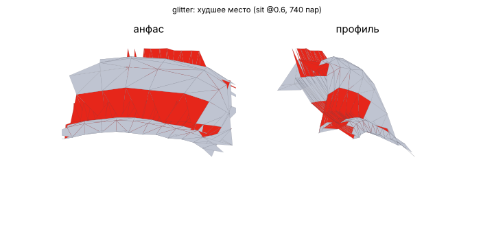

# Проникновения: glitter

Модель `glitter_v2.glb`, скрипт `scripts/models/penetration.py` (сетка — одна оболочка Tripo, части по цвету: бант/заколки, тело, худи, юбка).

Пересечение — два несмежных треугольника (без общей вершины) режут друг друга; «ладонь» — в паре треугольник кисти (рука касается лица/тела в позе — ожидаемый контакт, рантайм останавливает кисть по коллайдерам `public/models/<cat>_colliders.json`).

| поза | всего | складки скина (LBS у суставов) | контакт конечностей | прочие | пары частей (больше всего) |
|---|---|---|---|---|---|
| покой | 0 | 0 | 0 | 0 | — |
| cover_ears @0.3 | 617 | 268 | 349 | 0 | тело ↔ худи ↔ контакт: 207; худи ↔ худи ↔ складка: 167; тело ↔ тело ↔ контакт: 139; тело ↔ худи ↔ складка: 73; тело ↔ тело ↔ складка: 20 |
| cover_ears @0.5 | 596 | 240 | 353 | 3 | тело ↔ худи ↔ контакт: 197; тело ↔ тело ↔ контакт: 149; худи ↔ худи ↔ складка: 146; тело ↔ худи ↔ складка: 62; тело ↔ тело ↔ складка: 24 |
| poke_cheek @0.4 | 557 | 236 | 321 | 0 | худи ↔ худи ↔ складка: 165; тело ↔ худи ↔ контакт: 117; тело ↔ тело ↔ контакт: 117; худи ↔ худи ↔ контакт: 87; тело ↔ худи ↔ складка: 41 |
| cry @0.5 | 1021 | 317 | 616 | 88 | тело ↔ худи ↔ контакт: 326; тело ↔ тело ↔ контакт: 239; худи ↔ худи ↔ складка: 141; тело ↔ тело ↔ складка: 114; худи ↔ худи ↔ контакт: 49 |
| shy @0.5 | 744 | 342 | 337 | 65 | худи ↔ худи ↔ складка: 176; тело ↔ худи ↔ контакт: 119; тело ↔ тело ↔ контакт: 117; тело ↔ худи ↔ складка: 100; худи ↔ худи ↔ контакт: 91 |
| cheer @0.3 | 594 | 151 | 433 | 10 | тело ↔ тело ↔ контакт: 221; тело ↔ худи ↔ контакт: 212; тело ↔ тело ↔ складка: 67; тело ↔ худи ↔ складка: 56; тело ↔ юбка ↔ складка: 13 |
| cheer @0.6 | 214 | 169 | 13 | 32 | тело ↔ тело ↔ складка: 67; худи ↔ худи ↔ складка: 50; тело ↔ худи ↔ складка: 36; мех-оболочка ↔ худи: 17; тело ↔ юбка ↔ складка: 14 |
| celebrate @0.4 | 638 | 105 | 357 | 176 | тело ↔ худи ↔ контакт: 205; тело ↔ тело ↔ контакт: 139; пряди меха ↔ худи: 100; мех-оболочка ↔ худи: 72; худи ↔ худи ↔ складка: 61 |
| idle_stretch @0.5 | 123 | 59 | 61 | 3 | тело ↔ худи ↔ контакт: 35; худи ↔ худи ↔ складка: 29; тело ↔ тело ↔ контакт: 26; тело ↔ худи ↔ складка: 17; тело ↔ тело ↔ складка: 11 |
| sit @0.6 | 1821 | 740 | 409 | 672 | фатин ↔ фатин: 361; фатин ↔ тело: 296; тело ↔ худи ↔ складка: 265; тело ↔ тело ↔ складка: 261; тело ↔ худи ↔ контакт: 205 |
| sit @0.9 | 936 | 430 | 376 | 130 | тело ↔ худи ↔ контакт: 204; тело ↔ тело ↔ складка: 185; худи ↔ худи ↔ складка: 178; худи ↔ худи ↔ контакт: 128; фатин ↔ фатин: 102 |
| scared_01 @0.5 | 644 | 297 | 336 | 11 | тело ↔ худи ↔ контакт: 217; худи ↔ худи ↔ складка: 178; худи ↔ худи ↔ контакт: 77; тело ↔ худи ↔ складка: 76; тело ↔ тело ↔ контакт: 41 |
| frightened @0.5 | 814 | 159 | 581 | 74 | фатин ↔ тело ↔ ладонь: 269; тело ↔ тело ↔ контакт: 139; худи ↔ худи ↔ складка: 103; тело ↔ худи ↔ контакт: 89; фатин ↔ худи: 56 |
| fold_arms @0.6 | 663 | 220 | 443 | 0 | тело ↔ худи ↔ контакт: 167; тело ↔ тело ↔ контакт: 145; худи ↔ худи ↔ складка: 140; худи ↔ худи ↔ контакт: 122; тело ↔ худи ↔ складка: 57 |
| hug @0.5 | 990 | 127 | 636 | 227 | фатин ↔ тело ↔ ладонь: 314; фатин ↔ худи: 204; тело ↔ тело ↔ контакт: 165; худи ↔ худи ↔ складка: 85; тело ↔ худи ↔ контакт: 62 |
| idle_hooligan_headphones @0.4 | 477 | 217 | 260 | 0 | худи ↔ худи ↔ складка: 160; тело ↔ худи ↔ контакт: 103; тело ↔ тело ↔ контакт: 82; худи ↔ худи ↔ контакт: 74; тело ↔ худи ↔ складка: 45 |
| think @0.5 | 821 | 190 | 531 | 100 | тело ↔ тело ↔ контакт: 222; худи ↔ худи ↔ складка: 132; тело ↔ худи ↔ контакт: 97; фатин ↔ тело ↔ ладонь: 92; худи ↔ худи ↔ контакт: 89 |
| scratch @0.5 | 61 | 54 | 3 | 4 | тело ↔ тело ↔ складка: 17; худи ↔ худи ↔ складка: 17; тело ↔ худи ↔ складка: 16; тело ↔ юбка ↔ складка: 3; тело ↔ тело ↔ контакт: 3 |

Худшее место: поза «sit @0.6», 740 пар — `penetration_glitter.png`

Покой: **0** пересечений.

Позы: «складка скина» — линейный скин (LBS) сминает сетку у плеча/локтя/колена (подмышка в руках вверх, сгиб в присяде); без корректирующих ключей это неизбежно в любой статичной сетке. «Контакт конечностей» — рука касается лица/тела/другой руки (закрыть уши, скрестить руки, обнять): поза так задумана; в рантайме кисть останавливают коллайдеры `public/models/<cat>_colliders.json`. «Прочие» — всё остальное (одежда сквозь тело, мех/пряди сквозь одежду): в позах должно быть 0 или единицы на стыках.
