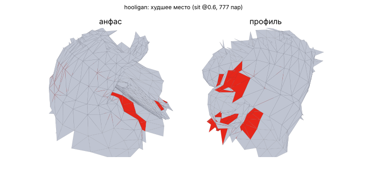

# Проникновения: hooligan

Модель `hooligan_v2.glb`, скрипт `scripts/models/penetration.py` (сетка — одна оболочка Tripo, части по цвету: кепка, наушники, обувь, тело, худи).

Пересечение — два несмежных треугольника (без общей вершины) режут друг друга; «ладонь» — в паре треугольник кисти (рука касается лица/тела в позе — ожидаемый контакт, рантайм останавливает кисть по коллайдерам `public/models/<cat>_colliders.json`).

| поза | всего | складки скина (LBS у суставов) | контакт конечностей | прочие | пары частей (больше всего) |
|---|---|---|---|---|---|
| покой | 0 | 0 | 0 | 0 | — |
| cover_ears @0.3 | 1339 | 379 | 540 | 420 | худи ↔ худи ↔ складка: 320; наушники (деталь) ↔ тело: 248; тело ↔ худи ↔ контакт: 244; тело ↔ тело ↔ контакт: 182; наушники (деталь) ↔ худи: 172 |
| cover_ears @0.5 | 1355 | 348 | 579 | 428 | худи ↔ худи ↔ складка: 296; наушники (деталь) ↔ тело: 262; тело ↔ худи ↔ контакт: 240; тело ↔ тело ↔ контакт: 189; наушники (деталь) ↔ худи: 166 |
| poke_cheek @0.4 | 1223 | 329 | 640 | 254 | наушники (деталь) ↔ тело: 251; худи ↔ худи ↔ складка: 235; тело ↔ тело ↔ контакт: 223; тело ↔ худи ↔ контакт: 189; наушники (деталь) ↔ тело ↔ ладонь: 134 |
| cry @0.5 | 1813 | 252 | 1041 | 520 | тело ↔ худи ↔ контакт: 532; наушники (деталь) ↔ тело: 344; тело ↔ тело ↔ контакт: 267; худи ↔ худи ↔ складка: 194; наушники (деталь) ↔ тело ↔ ладонь: 190 |
| shy @0.5 | 1473 | 561 | 346 | 566 | наушники (деталь) ↔ тело: 358; худи ↔ худи ↔ складка: 244; тело ↔ худи ↔ контакт: 168; мех-оболочка ↔ худи: 142; тело ↔ тело ↔ складка: 132 |
| cheer @0.3 | 1089 | 470 | 378 | 241 | худи ↔ худи ↔ складка: 235; тело ↔ тело ↔ контакт: 207; тело ↔ худи ↔ складка: 200; тело ↔ худи ↔ контакт: 162; наушники (деталь) ↔ тело: 122 |
| cheer @0.6 | 536 | 315 | 67 | 154 | худи ↔ худи ↔ складка: 168; тело ↔ худи ↔ складка: 127; наушники (деталь) ↔ тело: 75; тело ↔ тело ↔ контакт: 54; пряди меха ↔ худи: 40 |
| celebrate @0.4 | 963 | 263 | 320 | 380 | худи ↔ худи ↔ складка: 213; тело ↔ тело ↔ контакт: 168; наушники (деталь) ↔ худи: 155; тело ↔ худи ↔ контакт: 139; пряди меха ↔ худи: 122 |
| idle_stretch @0.5 | 231 | 91 | 49 | 91 | наушники (деталь) ↔ тело: 89; худи ↔ худи ↔ складка: 72; тело ↔ тело ↔ контакт: 39; тело ↔ худи ↔ складка: 13; тело ↔ худи ↔ контакт: 10 |
| sit @0.6 | 1405 | 777 | 396 | 232 | худи ↔ худи ↔ складка: 425; тело ↔ худи ↔ контакт: 292; тело ↔ худи ↔ складка: 194; тело ↔ тело ↔ складка: 158; наушники (деталь) ↔ тело: 142 |
| sit @0.9 | 1373 | 609 | 573 | 191 | худи ↔ худи ↔ складка: 285; тело ↔ худи ↔ контакт: 257; наушники (деталь) ↔ тело ↔ ладонь: 203; тело ↔ худи ↔ складка: 171; наушники (деталь) ↔ тело: 159 |
| scared_01 @0.5 | 910 | 313 | 597 | 0 | наушники (деталь) ↔ тело ↔ ладонь: 279; тело ↔ худи ↔ контакт: 242; худи ↔ худи ↔ складка: 162; худи ↔ худи ↔ контакт: 65; тело ↔ тело ↔ складка: 56 |
| frightened @0.5 | 915 | 219 | 497 | 199 | худи ↔ худи ↔ складка: 180; тело ↔ худи ↔ контакт: 176; наушники (деталь) ↔ тело ↔ ладонь: 143; наушники (деталь) ↔ тело: 126; тело ↔ тело ↔ контакт: 125 |
| fold_arms @0.6 | 872 | 416 | 344 | 112 | худи ↔ худи ↔ складка: 270; тело ↔ тело ↔ контакт: 203; тело ↔ худи ↔ складка: 139; худи ↔ худи ↔ контакт: 117; наушники (деталь) ↔ худи: 65 |
| hug @0.5 | 599 | 129 | 340 | 130 | тело ↔ худи ↔ контакт: 179; худи ↔ худи ↔ складка: 125; худи ↔ худи ↔ контакт: 107; наушники (деталь) ↔ тело: 96; тело ↔ тело ↔ контакт: 54 |
| idle_hooligan_headphones @0.4 | 1044 | 405 | 512 | 127 | худи ↔ худи ↔ складка: 290; тело ↔ худи ↔ контакт: 192; тело ↔ тело ↔ контакт: 179; тело ↔ худи ↔ складка: 105; наушники (деталь) ↔ худи: 103 |
| think @0.5 | 913 | 207 | 610 | 96 | тело ↔ худи ↔ контакт: 183; худи ↔ худи ↔ складка: 176; тело ↔ тело ↔ контакт: 166; наушники (деталь) ↔ тело ↔ ладонь: 164; худи ↔ худи ↔ контакт: 96 |
| scratch @0.5 | 242 | 182 | 12 | 48 | худи ↔ худи ↔ складка: 120; тело ↔ худи ↔ складка: 57; наушники (деталь) ↔ тело: 47; тело ↔ тело ↔ контакт: 9; тело ↔ тело ↔ складка: 5 |

Худшее место: поза «sit @0.6», 777 пар — `penetration_hooligan.png`

Покой: **0** пересечений.

Позы: «складка скина» — линейный скин (LBS) сминает сетку у плеча/локтя/колена (подмышка в руках вверх, сгиб в присяде); без корректирующих ключей это неизбежно в любой статичной сетке. «Контакт конечностей» — рука касается лица/тела/другой руки (закрыть уши, скрестить руки, обнять): поза так задумана; в рантайме кисть останавливают коллайдеры `public/models/<cat>_colliders.json`. «Прочие» — всё остальное (одежда сквозь тело, мех/пряди сквозь одежду): в позах должно быть 0 или единицы на стыках.
