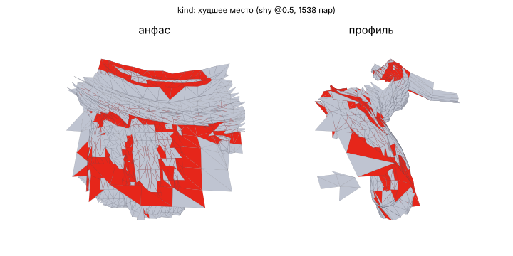

# Проникновения: kind

Модель `kind_v2.glb`, скрипт `scripts/models/penetration.py` (сетка — одна оболочка Tripo, части по цвету: обувь, тело, худи, шарф).

Пересечение — два несмежных треугольника (без общей вершины) режут друг друга; «ладонь» — в паре треугольник кисти (рука касается лица/тела в позе — ожидаемый контакт, рантайм останавливает кисть по коллайдерам `public/models/<cat>_colliders.json`).

| поза | всего | складки скина (LBS у суставов) | контакт конечностей | прочие | пары частей (больше всего) |
|---|---|---|---|---|---|
| покой | 0 | 0 | 0 | 0 | — |
| cover_ears @0.3 | 857 | 753 | 104 | 0 | худи ↔ шарф ↔ складка: 256; худи ↔ худи ↔ складка: 239; шарф ↔ шарф ↔ складка: 100; тело ↔ худи ↔ складка: 95; худи ↔ шарф ↔ контакт: 54 |
| cover_ears @0.5 | 827 | 696 | 131 | 0 | худи ↔ шарф ↔ складка: 242; худи ↔ худи ↔ складка: 231; шарф ↔ шарф ↔ складка: 97; тело ↔ худи ↔ складка: 72; тело ↔ шарф ↔ контакт: 66 |
| poke_cheek @0.4 | 757 | 482 | 275 | 0 | худи ↔ худи ↔ складка: 156; шарф ↔ шарф ↔ складка: 154; тело ↔ шарф ↔ контакт: 124; худи ↔ шарф ↔ складка: 114; худи ↔ худи ↔ контакт: 111 |
| cry @0.5 | 1125 | 523 | 579 | 23 | тело ↔ шарф ↔ контакт: 303; худи ↔ худи ↔ складка: 164; худи ↔ шарф ↔ складка: 148; тело ↔ шарф ↔ складка: 91; тело ↔ худи ↔ контакт: 85 |
| shy @0.5 | 1690 | 1538 | 148 | 4 | шарф ↔ шарф ↔ складка: 630; худи ↔ шарф ↔ складка: 390; обувь ↔ обувь ↔ складка: 162; худи ↔ худи ↔ складка: 157; худи ↔ худи ↔ контакт: 100 |
| cheer @0.3 | 681 | 290 | 391 | 0 | тело ↔ тело ↔ контакт: 198; тело ↔ худи ↔ контакт: 170; худи ↔ шарф ↔ складка: 94; худи ↔ худи ↔ складка: 84; тело ↔ худи ↔ складка: 57 |
| cheer @0.6 | 219 | 219 | 0 | 0 | тело ↔ худи ↔ складка: 128; худи ↔ худи ↔ складка: 65; худи ↔ шарф ↔ складка: 11; тело ↔ тело ↔ складка: 8; шарф ↔ шарф ↔ складка: 5 |
| celebrate @0.4 | 711 | 325 | 300 | 86 | тело ↔ худи ↔ контакт: 140; худи ↔ шарф ↔ складка: 137; тело ↔ тело ↔ контакт: 109; худи ↔ худи ↔ складка: 91; мех-оболочка ↔ худи: 44 |
| idle_stretch @0.5 | 276 | 274 | 0 | 2 | худи ↔ шарф ↔ складка: 124; тело ↔ худи ↔ складка: 67; шарф ↔ шарф ↔ складка: 40; худи ↔ худи ↔ складка: 33; тело ↔ тело ↔ складка: 10 |
| sit @0.6 | 1406 | 1111 | 295 | 0 | худи ↔ худи ↔ складка: 411; тело ↔ худи ↔ складка: 212; тело ↔ тело ↔ складка: 156; худи ↔ шарф ↔ складка: 145; тело ↔ худи ↔ контакт: 139 |
| sit @0.9 | 1482 | 851 | 581 | 50 | худи ↔ худи ↔ складка: 282; худи ↔ худи ↔ контакт: 215; тело ↔ худи ↔ складка: 204; тело ↔ шарф ↔ контакт: 189; тело ↔ худи ↔ контакт: 177 |
| scared_01 @0.5 | 1058 | 649 | 409 | 0 | тело ↔ худи ↔ складка: 185; тело ↔ шарф ↔ контакт: 163; худи ↔ худи ↔ складка: 162; тело ↔ худи ↔ контакт: 141; худи ↔ шарф ↔ складка: 136 |
| frightened @0.5 | 881 | 525 | 356 | 0 | тело ↔ шарф ↔ контакт: 169; худи ↔ худи ↔ складка: 165; шарф ↔ шарф ↔ складка: 127; худи ↔ шарф ↔ складка: 121; тело ↔ худи ↔ складка: 98 |
| fold_arms @0.6 | 990 | 539 | 451 | 0 | худи ↔ худи ↔ складка: 248; худи ↔ худи ↔ контакт: 154; тело ↔ тело ↔ контакт: 145; тело ↔ худи ↔ складка: 119; худи ↔ шарф ↔ складка: 112 |
| hug @0.5 | 571 | 194 | 377 | 0 | худи ↔ худи ↔ контакт: 164; тело ↔ худи ↔ контакт: 130; худи ↔ худи ↔ складка: 101; тело ↔ тело ↔ контакт: 83; шарф ↔ шарф ↔ складка: 46 |
| idle_hooligan_headphones @0.4 | 599 | 408 | 191 | 0 | худи ↔ худи ↔ складка: 231; тело ↔ шарф ↔ контакт: 96; худи ↔ шарф ↔ складка: 87; худи ↔ худи ↔ контакт: 74; тело ↔ худи ↔ складка: 36 |
| think @0.5 | 633 | 333 | 300 | 0 | худи ↔ худи ↔ складка: 141; худи ↔ худи ↔ контакт: 123; шарф ↔ шарф ↔ складка: 87; худи ↔ шарф ↔ складка: 69; тело ↔ худи ↔ контакт: 68 |
| scratch @0.5 | 182 | 172 | 8 | 2 | худи ↔ худи ↔ складка: 57; тело ↔ худи ↔ складка: 50; худи ↔ шарф ↔ складка: 33; шарф ↔ шарф ↔ складка: 21; тело ↔ тело ↔ складка: 10 |

Худшее место: поза «shy @0.5», 1538 пар — `penetration_kind.png`

Покой: **0** пересечений.

Позы: «складка скина» — линейный скин (LBS) сминает сетку у плеча/локтя/колена (подмышка в руках вверх, сгиб в присяде); без корректирующих ключей это неизбежно в любой статичной сетке. «Контакт конечностей» — рука касается лица/тела/другой руки (закрыть уши, скрестить руки, обнять): поза так задумана; в рантайме кисть останавливают коллайдеры `public/models/<cat>_colliders.json`. «Прочие» — всё остальное (одежда сквозь тело, мех/пряди сквозь одежду): в позах должно быть 0 или единицы на стыках.
